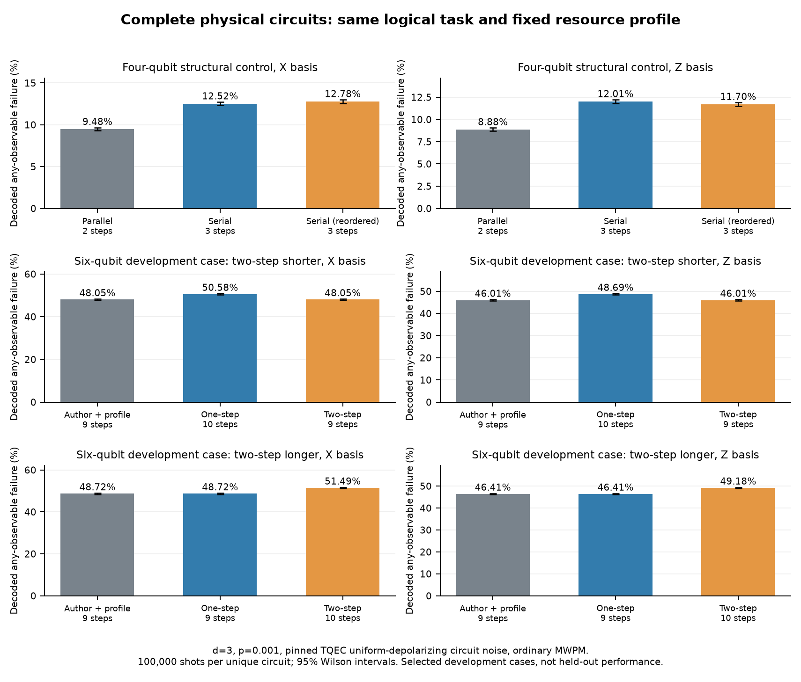

# DASCOT Lookahead Routing and Quantum Calibration

Research implementation for our **2026-11-09** report. The repository is named `Descot`; the underlying compilation method is **DASCOT**.

**中文導覽：** [11/2 完整公開 hs4_n4 整合](docs/updates/2026-11-02-public-hs4.md) · [11/6 前完成、11/9 報告的進度規劃](docs/ROADMAP_2026-11-09_ZH.md) · [11/2 不同排程的完整電路比較](docs/updates/2026-11-02.md) · [11/2 助教回饋與提前交付](docs/updates/2026-11-02-plan.md) · [公開 benchmark 與創新候選](docs/BENCHMARK_AND_NOVELTY_PLAN_ZH.md) · [11/1 受限路由轉譯](docs/updates/2026-11-01.md) · [10/31 三位元與儲存實測](docs/updates/2026-10-31.md) · [10/30 連續 CNOT](docs/updates/2026-10-30.md) · [Phase 1 詳細講稿與理解補充](docs/phase1/PROGRESS_ZH.md)

**Completion deadline:** all planned research deliverables and final presentation materials are due **2026-11-05 23:59 Asia/Taipei**, before Nov 6. The formal presentation remains Nov 9; Nov 6-8 are reserved for rehearsal and explicit corrections. See the roadmap for evidence gates and acceptance criteria.

## Current results

- **Routing:** bounded two-step lookahead, explicit score/budget accounting and controlled comparisons. 540 configurations / 1,620 executions; all schedules validated. On 24 held-out synthetic input/layout/seed pairs, median routed depth changes by **-3.69%** versus our one-step control with the same per-decision evaluation budget (16 wins, 8 ties, 0 losses). Versus the pinned author original: -2.42% (13/9/2).
- **Isolated CNOT calibration:** a spatial-bridge extension of pinned TQEC CNOT graphs; 32 settings / **3,200,000 shots**, signed-input/fault checks, graphlike distance diagnostics, counts and 95% Wilson intervals.
- **Continuous CNOT composition:** same-pair chains of 1/2/3 physical CNOTs, X/Z basis, d=3, spans 1/3 and p=0.001. **12 settings / 240,000 additional shots**; complete circuits sampled and decoded together. Even-length chains have ideal identity action. These deliberately unoptimized circuits are validation fixtures, not application workloads.
- **Three live qubits and storage:** CNOT(0,1) then CNOT(1,2), with aligned input/output times and spectator memory. X/Z, d=3, spans 1/3, zero/one extra storage block: **8 settings / 800,000 additional shots**. Complete-circuit any-observable failure increases in all four matched storage contrasts; counts and Wilson intervals are recorded. This remains a supported geometry, not arbitrary-route lowering.
- **Restricted route-to-circuit adapter:** 18 real-router configurations on declared custom layouts produce 72 supported requests and 8 unique validated physical circuits. Source paths may be normalized inside exclusively reserved empty corridors. Timing is an explicit template policy. Exact ideal/noisy circuit hashes permit reuse of the Oct 31 full-circuit calibration; **zero new Monte Carlo shots**. The full Phase 1 workloads remain outside this two-gate profile (0/540 records; 20 input/layout definitions). This is contract validation, not a scheduler-performance result.
- **Full-schedule pilot:** a conservative forward-CNOT layer profile supports parallel operations, stretched L bridges and protected live memory. Nine source schedules / 18 requests / 14 unique complete circuits / **1,400,000 new shots**. Both a shorter and a longer two-step development fixture are retained; these deliberately selected cases are not held-out algorithm-performance evidence. The author-search comparison uses the same new reservation primitive, not the unmodified author router.
- **Public workloads:** seven complete pinned QASMBench sources, expanded custom definitions, retained classical/measurement dependencies, and reproducible DAG/support audit. Complete `hs4_n4` now retains all 20 H, 4 virtual-X frame updates, 4 CX and 4 original terminal measurements. Four predeclared full-circuit controls / **400,000 new shots**; signed Z inputs, conjugate-X physical validation, original classical outputs and distance-3 checks. Validated public-source coverage is **1/7**; remaining sources keep explicit boundaries. These controls are not held-out scheduler-performance evidence.
- **Tests:** 109 passed locally. Check the Actions tab for remote CI results.



The routing and quantum components have separate validated scopes. **The scheduler quantum-risk weight remains zero** until a supported route-to-physical-circuit adapter and complete schedule composition are validated. A TQEC bridge span is not a DASCOT hop count. These rates are basis-specific logical-observable-set failures, not state/process fidelity.

## Setup and reproduce

Use **Python 3.12** and git. Tested locally on Python 3.12.14. The NumPy/SciPy lock requires Python >=3.12.

```bash
bash setup.sh
source .venv/bin/activate
python restore_results.py
python -m pytest tests -q
python verify_results.py
python run_routing.py --output results_fresh/routing
python run_surgery.py --output results_fresh/surgery --shots 100000
python run_composition.py --output results_fresh/composition --shots 20000
python run_three_qubit.py --output results_fresh/three_qubit
python report_public_clifford.py
python run_public_clifford.py --output results_fresh/public_hs4
python report_schedule_pilot.py
python run_public_audit.py --output results_fresh/public_audit
python run_schedule_pilot.py --output results_fresh/schedule_pilot
```

`setup.sh` installs the pinned dependencies and clones the pinned wisq source into `../external/wisq`. Set `TASK_PYTHON` if your Python 3.12 executable has another path. On Windows, use `py -3.12 -m venv .venv`, install `requirements-lock.txt` with that environment, and clone wisq at the pinned commit into `../external/wisq`.

Runners resume records already present in the selected output directory. **Use a fresh output directory to resample or retime.** The recorded inputs and mappings are frozen. Routing time measurements and quantum sampling are separate studies. The isolated routing timing pass should run without other local heavy benchmarks; the host itself is shared.

## Data and snapshots

Small records, inputs and summaries are directly versioned. Large raw schedules/circuits are stored in compressed milestone snapshots to keep the working tree readable:

- `archives/phase1_snapshot.zip`: frozen Phase 1 source and all 540 routing schedules, 32 CNOT settings and 72 isolated timing records.
- `archives/composition_2026-10-30.zip`: all 12 continuous-chain settings, ideal/noisy circuits, DEMs and counts.
- `archives/three_qubit_2026-10-31.zip`: all 8 three-live-qubit storage settings, circuits, DEMs, protocol and source provenance.
- `archives/adapter_2026-11-01.zip`: source routes, 72 requests/certificates, exact full-circuit reference checks, rejection and coverage records; no duplicate sampling.
- `archives/schedule_pilot_2026-11-02.zip`: all 18 requests/certificates, 14 complete ideal/noisy circuits and DEMs, 1.4M sampled shots, pre-noise fixture selection, isolated routing timing, record audit and test log.
- `archives/public_hs4_2026-11-02.zip`: complete public source integration, four ideal/noisy circuits and DEMs, 400k shots, signed/conjugate-generator validation, original classical readout, provenance, timing and audit.
- `archives/manifest.json`: exact archive SHA-256 and byte counts.

`restore_results.py` verifies the archives and restores result files without overwriting different existing files. The Phase 1 snapshot source is historical; the repository root is the current development source. GitHub's **Code → Download ZIP** contains both current source and these complete snapshots.

## Main files

| File / directory | Role |
|---|---|
| `lookahead.py`, `SCORE_SPEC.md` | Bounded score, candidate stream and budget definition |
| `run_routing.py`, `validation.py` | Paired abstract-routing experiments and independent legality checks |
| `surgery.py`, `run_surgery.py` | Isolated TQEC-backed CNOT geometry adapter and Monte Carlo |
| `composition.py`, `run_composition.py` | Continuous same-pair CNOT chains and logical-action checks |
| `three_qubit.py`, `run_three_qubit.py`, `report_three_qubit.py` | Non-cancelling three-live-qubit geometry, storage, full-circuit sampling and audit |
| `route_adapter.py`, `run_adapter_validation.py`, `report_adapter.py` | Fail-closed restricted synthesis, actual-router interoperability and exact full-circuit reuse |
| `schedule_circuit.py`, `schedule_adapter.py` | Bounded forward-CNOT layers, full reservations and memory, complete per-component observable basis |
| `run_schedule_pilot.py`, `report_schedule_pilot.py` | Predeclared positive/negative development comparisons, complete-circuit sampling and record audit |
| `public_clifford.py`, `public_readout.py`, `run_public_clifford.py`, `report_public_clifford.py` | Complete H/X/CX public-program implementation, oriented patches, exact Pauli frame/classical outputs, process validation and complete-circuit controls |
| `run_public_audit.py`, `benchmarks/` | Complete pinned public inputs, dependencies and physical support audit; transparent development-fixture selection |
| `qec_lookup.py` | Strict condition-matched isolated-gadget lookup; no extrapolation |
| `verify_results.py` | Frozen Phase 1 record audit without resampling |
| `make_composition_report.py` | Audit chain records and regenerate the dated Chinese report/figure |
| `results/analysis`, `results/surgery`, `results/composition` | Recorded results, counts and summaries |
| `docs/updates` | Chinese progress explanations; no routine slide regeneration |

## Provenance and interpretation

The base CNOT graph, graph composition and physical compiler are **TQEC upstream work**. Our additions are the bounded scheduler and controls, spatial-bridge adapter, composition/route-interface validation, calibration runners and result records. The two-CNOT identity fixture is retained physically to check composition; a logical optimizer could remove it.

Stim samples complete circuit faults. Decoding uses ordinary uncorrelated PyMatching MWPM on a decomposed DEM, without postselection. One shot fails if either selected correlation observable is mispredicted. Wilson intervals cover finite-shot uncertainty under the circuit/noise/decoder model. The TQEC uniform-depolarizing model differs from the earlier four-channel memory model; lookup values are never pooled across model IDs. Equal seeds alone do not ensure identical samples across package versions, SIMD widths or batching.

## References

- Molavi et al., *Dependency-Aware Compilation for Surface Code Quantum Architectures*. [Paper](https://arxiv.org/abs/2311.18042v3), [DOI](https://doi.org/10.1145/3720416).
- [wisq](https://github.com/qqq-wisc/wisq), commit `97c12a5e22cf16e37288c60a0a5735c58c6fe8ca`.
- [TQEC](https://github.com/tqec/tqec), commit `50fa2210597632a79bd266b56a5fb8d9b00747bb`; [original CNOT](https://tqec.github.io/tqec/gallery/cnot.html).
- Gidney, *Stim: a fast stabilizer circuit simulator*, [Quantum 5, 497 (2021)](https://doi.org/10.22331/q-2021-07-06-497).
- [PyMatching documentation](https://pymatching.readthedocs.io/en/stable/toric-code-example.html).

Third-party license texts accompany the repository. The [frozen Phase 1 reproduction notes](docs/phase1/REPRODUCTION.md) describe that milestone separately.
