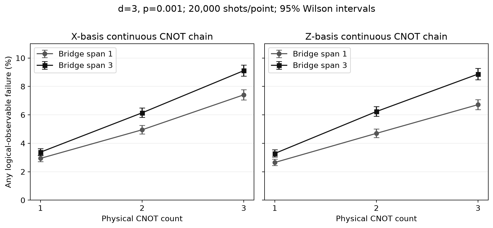

# 2026-10-30 進度：從單一 CNOT，前進到連續量子操作

## 今天新增了什麼

上一個版本已能回答「一個 CNOT 在某個幾何／noise 條件下，錯誤率是多少」。今天新增的能力是：**讓同一對邏輯量子位元連續完成 1、2、3 次 CNOT，編成一條持續存在的物理電路，最後一起抽樣、解碼。**

我們使用 TQEC 原有的 block-graph composition 與 compiler，新增可調 bridge span 的串接流程、邏輯作用驗證、完整電路的實驗 runner 和結果紀錄。這個進度是後續串接 DASCOT 排程的驗證起點；graph composition 方法本身仍歸原作者。

| 之前的能力 | 今天增加的能力 | 為什麼有用 |
|---|---|---|
| 每個 CNOT 各自初始化、各自讀出 | 整個 CNOT 鏈只在兩端定義輸入與輸出 | 邏輯狀態可以穿過操作接合處 |
| 校準孤立操作 | 對連續完整電路的 syndrome 一起解碼 | 可以研究跨操作的錯誤傳播與解碼 |
| 單次 CNOT 的輸入符號檢查 | 區分奇數次 CNOT 與偶數次 identity | 檢查串接後邏輯作用有沒有被破壞 |
| 21 項測試 | 27 項測試通過 | 增加串接、長 bridge、符號、fault 與距離驗證 |

## 先用白話理解這件事

CNOT 會依控制位元改變目標位元。同方向、同一對位元連做兩次，理想上會還原，所以 CNOT × CNOT = identity。這不代表兩次實體操作沒有成本：量子位元仍然經歷了儲存、操作與量測相關的 noise。這是一個很好檢查串接是否正確的案例。

一般邏輯最佳化器可以刪掉這對抵銷的 CNOT。本次刻意保留實體操作，用它作為驗證測試；它不是應用電路效能改善的證據。下一個案例會擴充成三個邏輯位元、不能直接抵銷的 CNOT 鏈。

今天不是把兩份各自讀出完的 `.stim` 檔直接接在一起。那樣第一份已量測結束，不能直接代表同一份量子狀態繼續演化。我們先接合未封閉輸入／輸出的 block graphs，再編譯整條物理電路。

## 實際跑出的結果

設定：X/Z basis、distance 3、bridge span 1/3、實體 CNOT 數 1/2/3、p=0.001。使用與 Phase 1 相同的 TQEC uniform-depolarizing model 與 ordinary uncorrelated MWPM。共 12 組，每組 20,000 shots，合計 **240,000 shots**。一個 shot 的兩個指定 logical correlation observables 任一解碼錯誤即計一次。



| Basis | Span | CNOT數 | 理想作用 | Qubits | TICKs | 錯誤次數／20000 | 錯誤率 | 95% Wilson CI |
|---|---:|---:|---|---:|---:|---:|---:|---|
| X | 1 | 1 | CNOT | 81 | 83 | 588 | 2.940% | [2.715%, 3.183%] |
| X | 1 | 2 | identity | 81 | 146 | 990 | 4.950% | [4.658%, 5.259%] |
| X | 1 | 3 | CNOT | 81 | 209 | 1482 | 7.410% | [7.055%, 7.781%] |
| X | 3 | 1 | CNOT | 137 | 83 | 675 | 3.375% | [3.134%, 3.634%] |
| X | 3 | 2 | identity | 137 | 146 | 1229 | 6.145% | [5.821%, 6.486%] |
| X | 3 | 3 | CNOT | 137 | 209 | 1822 | 9.110% | [8.719%, 9.517%] |
| Z | 1 | 1 | CNOT | 81 | 83 | 530 | 2.650% | [2.436%, 2.882%] |
| Z | 1 | 2 | identity | 81 | 146 | 940 | 4.700% | [4.415%, 5.002%] |
| Z | 1 | 3 | CNOT | 81 | 209 | 1344 | 6.720% | [6.381%, 7.075%] |
| Z | 3 | 1 | CNOT | 137 | 83 | 657 | 3.285% | [3.047%, 3.541%] |
| Z | 3 | 2 | identity | 137 | 146 | 1247 | 6.235% | [5.908%, 6.579%] |
| Z | 3 | 3 | CNOT | 137 | 209 | 1774 | 8.870% | [8.484%, 9.272%] |

以 Z basis、span 1 為例：一／二／三次 CNOT 使用 83／146／209 個 TICKs，錯誤率分別為 2.650%／4.700%／6.720%。兩次 CNOT 的理想作用雖然是 identity，仍可量到完整物理流程的風險。這些計數描述不同完整電路任務，不能只把變化歸因於單一等待時間參數。

TICK 仍是電路排程標記，不是直接的 ns 或 syndrome 輪數。27 項測試在本地通過；GitHub Actions 的結果要另看該次 workflow，不能把本地結果當作遠端 CI 已成功。

## 怎麼知道接對了

每個設定都以四種輸入符號測試，對照預期的 CNOT／identity 邏輯關係；使用原始 measurement-to-detector converter。另注入已知的最終控制位元 logical flip，檢查對應 observable 改變且沒有 detector event。12 個理想電路的 shortest graphlike error 長度皆為 3。

抽樣由整個 noisy circuit 產生，再對完整 DEM 解碼；沒有 postselection。保存每批 counts、seed、電路 hash、原始 `.stim`／`.dem` 和 95% Wilson CI。結果核對見 `results/composition/record_audit.json`。

## 現在可以說到哪裡

已驗證「固定幾何、同一對位元」的連續操作流程，跨過了只測孤立 gadget 的階段。這仍不是任意 DASCOT 路徑的物理轉譯，也沒有啟用 scheduler 的量子風險項；mu 仍為 0。觀測值也不是 state/process fidelity。

## 下一步與 11/9 目標

先擴充三個位元的非抵銷操作，再明確定義哪些路由幾何能對應到物理 gadget，補齊存活狀態的 memory。11/4–11/5 的主要整合目標，是在小型受限 workload 上比較完整電路；11/6 凍結數據，11/8 整理正式報告。

完整規劃：[11/9 前進度表](../ROADMAP_2026-11-09_ZH.md)。日常更新會使用這種中文說明與實測圖表。

## 如何重現

在已安裝 pinned requirements 的 Python 3.12 環境：

```bash
python -m pytest tests -q
python run_composition.py --output results_fresh/composition --shots 20000
```

預設 runner 會沿用已有的結果；要重新抽樣，務必使用新的 output 目錄。固定版本的原始電路包含於 `archives/composition_2026-10-30.zip`。

來源：TQEC commit `50fa2210597632a79bd266b56a5fb8d9b00747bb` 的 `BlockGraph.compose`、gallery CNOT 與 physical compiler；[官方 CNOT 範例](https://tqec.github.io/tqec/gallery/cnot.html)。我們新增的程式是 `composition.py`、`run_composition.py` 與對應的驗證／紀錄流程。
