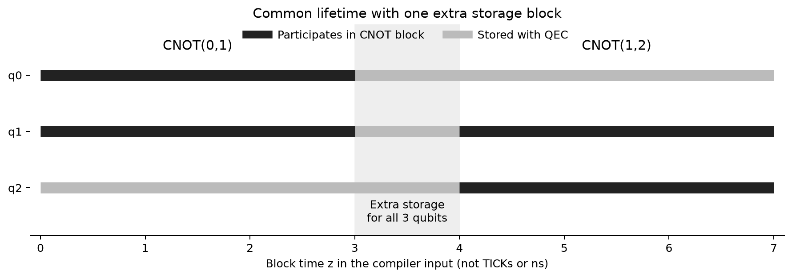
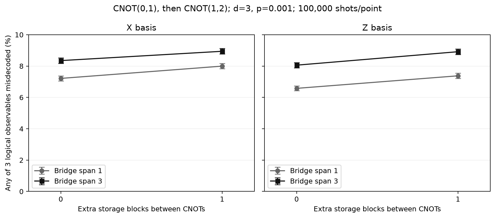

# 2026-10-31：三個邏輯位元、非抵銷 CNOT 與等待成本

## 今天新增了什麼

已建立 **CNOT(0,1) → CNOT(1,2)** 的完整 lattice-surgery 電路。三個邏輯位元從同一時間初始化，一直存活到共同讀出；其中沒有正在參與 gate 的位元，也持續經過 QEC memory。另加入「中間額外等待 0／1 個 storage block」的控制比較。

本次完成 8 組設定、每組 100,000 shots，合計 **800,000 次完整電路抽樣**。41 項本地測試通過；遠端 CI 狀態以本次 commit 的 Actions 紀錄為準。

## 和昨天差在哪裡、為什麼有用

昨天是同一對位元重複 CNOT，兩次理想上可以抵銷。今天換成不同的控制／目標配對，不能直接抵銷。例如 Z basis 的輸入 `100`，先變 `110`、再變 `111`；這是一個實際的資訊傳遞鏈。

| 之前 | 今天 | 對研究的意義 |
|---|---|---|
| 同一對位元的重複 gate | 三個位元、兩種 gate 配對 | 往可代表實際工作負載的連續操作推進 |
| 兩個 observable 的任一錯誤 | 三個獨立 correlation observable 的任一錯誤 | 能追蹤完整三位元任務 |
| 操作的初始化／讀出已接起 | 所有邏輯位元共同開始、共同結束 | 不會漏算尚未用到或已完成 gate 的存活狀態 |
| 無獨立等待控制 | 相同工作與幾何，只增加一個 storage block | 量測排程等待造成的物理成本 |

我們使用 TQEC 原有的 CNOT graph、`BlockGraph.compose` 與 physical compiler。新增部分是三位元幾何、時間對齊與 storage padding、獨立邏輯作用檢查，以及這次實驗與紀錄；graph composition 方法本身仍歸原作者。

## 白話理解：沒在做 gate，為什麼仍要算進電路？

做第一個 CNOT 時，q2 還沒輪到，但它的量子狀態已存在，仍然需要儲存保護。做第二個 CNOT 時，q0 雖然完成自己的 gate，狀態也必須保留到最後。若讓 q2 晚一點才初始化、q0 提早讀出，會漏掉這些等待期間的 noise，與完整排程的狀態生命週期不同。



圖中灰色段是有 QEC 的儲存，黑色段是參與 CNOT block；黑色不代表每個微觀 TICK 都是雙位元 gate。橫軸是 TQEC block graph 的 z，不是 ns，也不是 TICK。新增一個 storage block 後，本次編譯出的實際 TICK 數由 146 變 167，沒有把 block 數直接當物理時間。

## 完整電路的實測數據

共同條件：d=3、p=0.001，TQEC `uniform_depolarizing` circuit model；ordinary uncorrelated PyMatching MWPM，使用 decomposed DEM、無 postselection。每個 shot 的三個指定 correlation observables，只要任一解碼錯誤，即記一次 any failure。所有數值都是完整 noisy circuit 抽樣，不是單一 gadget 查表相乘。



| Basis | Bridge span | 額外 storage blocks | Qubits | TICKs | 錯誤次數／100000 | 錯誤率 | 95% Wilson CI |
|---|---:|---:|---:|---:|---:|---:|---|
| X | 1 | 0 | 137 | 146 | 7212 | 7.212% | [7.053%, 7.374%] |
| X | 1 | 1 | 137 | 167 | 7995 | 7.995% | [7.829%, 8.165%] |
| X | 3 | 0 | 249 | 146 | 8348 | 8.348% | [8.178%, 8.521%] |
| X | 3 | 1 | 249 | 167 | 8942 | 8.942% | [8.767%, 9.120%] |
| Z | 1 | 0 | 137 | 146 | 6577 | 6.577% | [6.425%, 6.732%] |
| Z | 1 | 1 | 137 | 167 | 7377 | 7.377% | [7.217%, 7.541%] |
| Z | 3 | 0 | 249 | 146 | 8057 | 8.057% | [7.890%, 8.227%] |
| Z | 3 | 1 | 249 | 167 | 8915 | 8.915% | [8.740%, 9.093%] |

在相同 basis／span 內，邏輯工作、qubit 用量、noise model 與 decoder 保持一致；改變的是中間 storage block。四組點估計的差異如下（單位為**百分點**，不是相對百分比）：

- X / span 1：7.212% → 7.995%，增加 0.783 個百分點。
- X / span 3：8.348% → 8.942%，增加 0.594 個百分點。
- Z / span 1：6.577% → 7.377%，增加 0.800 個百分點。
- Z / span 3：8.057% → 8.915%，增加 0.858 個百分點。

例如 Z / span 1，由 6.577% 增至 7.377%。這提供了「排程中的額外等待有量子錯誤成本」的實測依據。這個結論對應本次固定模型與受限幾何；不能直接替任意 DASCOT 路徑指定相同成本。

也不能把今天的錯誤率與昨天兩位元的數值直接相比：兩者的邏輯工作與 observable 數不同。今天的公平控制，是同一個三位元任務內比較有／無額外 storage block。

## 怎麼驗證不是只把電路接上就算完成

1. **邏輯關係：** 分別在 X/Z basis，以全部 8 種輸入符號檢查預期的非抵銷 CNOT 作用。使用真正 Pauli gates 改變輸入，再交給原始未修改的 measurement-to-detector converter。
2. **獨立性：** 三個 observable 的輸入 Pauli 生成元必須有 GF(2) rank 3。測試會拒絕誤換成 identity 的 flows。
3. **狀態存活：** 檢查 q0/q1/q2 從共同 z=0 到 z=6／7，每段時間都有實際的相連 storage／operation cubes。
4. **已知 fault：** 對每個最終邏輯位元分別注入 logical flip，檢查 observable 的預期改變且沒有 detector event。
5. **距離：** 8 個 noisy circuit 的 shortest graphlike error 長度皆為 3。這是指定模型與 observable set 的診斷，不是 threshold 測量。
6. **結果追溯：** 保存 ideal/noisy `.stim`、`.dem`、seed、每批 counts、per-observable counts、source hashes、package versions 和 CI。抽樣前固定 `protocol.json`；`record_audit.json` 核對電路／DEM hash 與計數。

完整原始資料位於 `archives/three_qubit_2026-10-31.zip`；可讀結果位於 `results/three_qubit_2026-10-31/`。TQEC 的安裝來源已核對到固定 commit，並保留本次來源檢查方法。

## 現在可以說到哪裡、下一步做什麼

已完成三個存活邏輯位元的非抵銷操作與額外儲存比較。這使研究從「每個操作單獨有多容易錯」前進到「連續操作加上等待，整條電路有多容易解碼錯誤」。這些是 basis-specific logical-observable failure，仍不是 state/process fidelity。

下一步是定義受限 route-to-circuit adapter：明確列出可對應的邊界、方向與 ancilla footprint，把抽象路由的一個 step 對應到具體操作與存活狀態的 memory；不支援的幾何應拒絕轉譯。scheduler 的 **mu 保持 0**，尚未宣稱新路由已改善完整量子電路錯誤率。

## 重現

```bash
python -m pytest tests -q
python restore_results.py
python run_three_qubit.py --output results_fresh/three_qubit
python report_three_qubit.py
```

Runner 的八組設定固定，已有結果會 resume；重新抽樣需指定新的 output。Report 預設讀取凍結的 `results/three_qubit_2026-10-31/`，不會把 fresh results 自動當成凍結數據。相同 seed 在不同 SIMD、版本或批次設定下，不保證得到完全相同樣本。

來源：TQEC commit `50fa2210597632a79bd266b56a5fb8d9b00747bb` 的 [原 CNOT graph](https://github.com/tqec/tqec/blob/50fa2210597632a79bd266b56a5fb8d9b00747bb/src/tqec/gallery/cnot.py) 與 [block-graph composition](https://github.com/tqec/tqec/blob/50fa2210597632a79bd266b56a5fb8d9b00747bb/src/tqec/computation/block_graph.py)；抽樣與解碼使用 Stim 1.16.0／PyMatching 2.4.0。新增程式為 `three_qubit.py`、runner、測試與本次紀錄。
