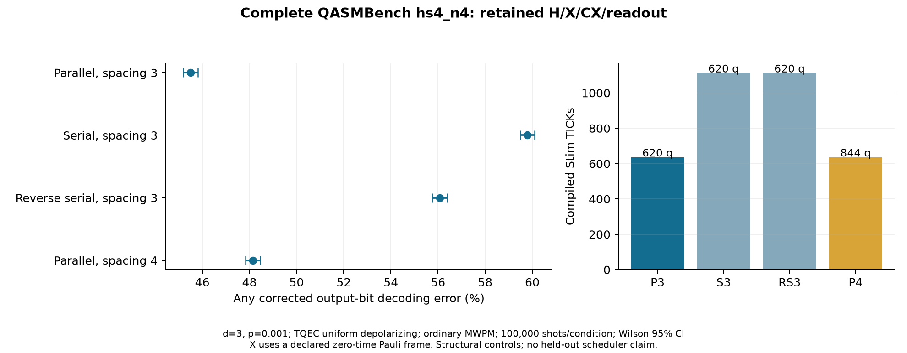
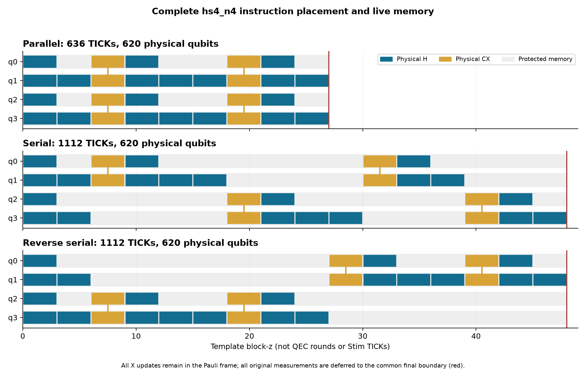

# 2026-11-02：完整公開 hs4_n4 的物理整合與排程控制實驗

## 新增了什麼、為什麼有用

前一輪已接通 CNOT 開發 fixture 的排程閉環；這一輪把 **QASMBench 原始 `hs4_n4` 全部 32 個指令**接到完整 surface-code 電路：20 H、4 X、4 CX、4 次 Z 量測。固定來源仍為 QASMBench commit `357b942396d5c2b7cbc1c229c585a6ef5ccaebac`，原檔、Git blob、SHA-256、license/notice 和 quantum/classical DAG 均保留。來源完整支援由 0/7 增至 **1/7**；其餘六份仍保留原稽核，沒有把未完成來源列為成功。

這次沒有刪 H、擷取 CX kernel 或消去相鄰 H。H 採用固定版本 TQEC 的 temporal-H 模板；**X 逐項執行為零實體時間的 Pauli frame**，經每個 H/CX 精確傳播，最後 XOR 回原 classical destination。這是本次明定的 gate implementation/noise policy，不是額外施加四個帶噪的 physical X。原始輸入 |0000〉的理想輸出，依 c0,c1,c2,c3 順序為 **[1,0,1,0]**（c3…c0 顯示為 `0101`）。`public_readout.py` 提供從完整 logical-observable bits 還原這四個 classical bits 的可執行介面。

H 會交換 patch 邊界方向；直接把 H 後的狀態接回原本固定方向 CNOT，可能得到不同的邏輯作用。本次追蹤每個 patch 的方向，依 control/target 方向建立相容的 ancilla 轉彎走廊，再先組合整個 block graph、最後才產生實體電路。所有資料 patch 從共同初始化一直保留到共同終端讀出；單一 qubit 較早 ready 的量測可延至共同末端，因為後續操作只作用於其他 qubits。此延後和完整等待成本明列於逐指令 certificate。

## 驗證方式

- 每份完整來源排程包含所有 32 指令，逐項檢查 quantum/classical dependencies、原始 classical destination、patch 方向和完整 data/ancilla 保留區域；存活 patch 每一段 temporal pipe 都必須存在。
- 每個條件檢查全部 16 種 Z 輸入符號、4 種 final logical faults、完整 input/output Z observable rank，以及包含原始 X 的邏輯 tableau／frame 關係。
- **Z 輸出相同仍不足以排除相位錯誤。** 每個條件另編譯 4 份混合基底電路，驗證各個 X generator 的完整傳播及全部 16 種輸入符號；與 Z generator 合起來檢查完整 Clifford 作用。這些電路是驗證用，沒有新增 noisy benchmark shots。
- 每份 benchmark noisy circuit 的 shortest graphlike logical error 都為 3；這是指定 decoder 圖模型的距離檢查，並非一般噪聲下的完整距離定理。
- 原始完整電路、DEM、seed、batch counts、counts/CI、逐指令 certificate、來源／程式／電路雜湊與獨立計時均保存；報表會重新核對這些紀錄。

## 完整量測

| 條件 | CX steps | H layers | block-z | QEC rounds | TICKs | Qubits | 錯誤／shots | 錯誤率與 95% CI |
|---|---:|---:|---:|---|---:|---:|---|---|
| 並行／spacing3 | 2 | 7 | 27 | 未推算 | 636 | 620 | 45506/100000 | 45.506% [45.198, 45.815] |
| 串行／spacing3 | 4 | 12 | 48 | 未推算 | 1112 | 620 | 59794/100000 | 59.794% [59.490, 60.098] |
| 反向選取串行／spacing3 | 4 | 12 | 48 | 未推算 | 1112 | 620 | 56074/100000 | 56.074% [55.766, 56.381] |
| 並行／spacing4 | 2 | 7 | 27 | 未推算 | 636 | 844 | 48138/100000 | 48.138% [47.828, 48.448] |

指標是同一個完整公開任務的 **4 個獨立 Z-correlation observables 任一解碼錯誤**；在此確定性輸出任務與可逆 readout mapping 下，等價於任一 corrected classical output bit 不正確。不是 process/state fidelity。固定 d=3、physical p=0.001、TQEC uniform-depolarizing circuit noise、普通 uncorrelated PyMatching MWPM、decomposed DEM、無 postselection。每個不同完整電路 100,000 shots；4 個條件共 **400,000 新 noisy shots**。區間為 Wilson 95%。



| 比較方向 | 差值（百分點） | 差值 95% CI |
|---|---:|---|
| 串行／spacing3 − 並行／spacing3 | +14.288 | [+13.854, +14.721] |
| 反向選取串行／spacing3 − 並行／spacing3 | +10.568 | [+10.132, +11.003] |
| 並行／spacing4 − 並行／spacing3 | +2.632 | [+2.195, +3.069] |
| 反向選取串行／spacing3 − 串行／spacing3 | -3.720 | [-4.152, -3.288] |

差值以第二條件減並行 spacing3，使用 Newcombe independent-proportions score interval；本次為探索性逐項 95%，沒有 familywise 校正。這些是預先指定的控制比較，不是新演算法的 held-out 勝率，也不能說 one-step 必須串行。

## 時間、資源與等待的解釋

時間欄位分開：**CX routing steps、H instruction layers、template block-z、QEC rounds、Stim TICKs**。每個 physical H 或 CX layer 固定 3 block-z；X frame 不佔 block-z。TQEC fixed-bulk temporal-H realignment 有額外的實體時序，因此 TICK 數由完整 compiler 直接計算，不以 CX steps 乘固定常數猜測。普通 block 在 k=1 的 bulk repetition 為 1，但含 H realignment／首尾邊界時不能把它直接當總 QEC rounds；本輪 `qec_rounds` 明列為 null／未推算，沒有偷換成 routing step 或 TICK。

**等總時長與資源仍可有不同風險。** 兩份串行控制同為 4 CX steps、12 H layers、48 block-z、1112 TICKs 和 620 qubits；反向選取版本的完整錯誤率低 3.720 個百分點，差值 95% CI [-4.152, -3.288]。兩個版本的 CX 起始 block-z 分別為 `(6,18,30,39)` 與 `(6,18,27,39)`，對應的 logical gate IDs／作用對象也不同。這支持分析完整 gate 時間配置，而不只比較總量；尚未透過分項實驗將差異唯一歸因於某個等待特徵。



反向選取僅反轉同時 ready 的 CX 優先序，不改相依 gate 的邏輯順序。串行兩個 logical pairs 的兩次 CX 起始間距分別為 24／21 block-z；反向選取為 12／12 block-z。這提供後續「等待位置／分布」候選的具體分析目標，仍需 calibration／held-out／ablation 才能評估決策規則。

串行控制只改每次允許的 CX 數與選取順序；所有條件使用同一個 H-ready-first DAG 政策、保留每個原始 H。在此全域同步政策下，CX 串行也可能把原本能一起執行的 H 拆成更多層。因此它量到的是**完整排程與等待政策的共同效果**，不能單獨歸因於 CX 深度。所有存活 patch 都受到保護；每條資料／ancilla 的保留 block-z 及逐 gate 時間在 certificate 和 record 中。

Spacing3 的三份排程使用相同幾何與可用 footprint；spacing4 是另一組幾何／資源取捨。後者不混作固定晶片資源下的演算法勝負。H 跟 CX 本身仍使用上游 physical compiler 的實體 QEC 與噪聲，沒有把單一 gadget 查表相乘當成本次完整錯誤率。

| 條件 | Scheduler 中位時間（ms） | repetitions |
|---|---:|---:|
| hs4_parallel_spacing3 | 0.055 | 25 |
| hs4_serial_spacing3 | 0.081 | 25 |
| hs4_serial_reverse_spacing3 | 0.080 | 25 |
| hs4_parallel_spacing4 | 0.055 | 25 |

這裡的計時是**完整指令 DAG scheduler 本身**，不是舊 Phase 1 DASCOT routing 的時間，也不含 graph compilation、X-generator 驗證、Monte Carlo 或 MWPM。正式報告的計時另在全部本機測試／物理工作結束後獨立執行 3 次 warmup、25 次 repetitions，保存在 `scheduler_timing_isolated.json`；主機仍可能共享。原始 runner 的 `scheduler_timing.json` 在另一個驗證測試程序活動時取得，保留作診斷，未作本表證據。既有 DASCOT original／同預算 one-step／two-step 與獨立 routing 計時仍保留，不以這組控制排程取代。

## 現況、貢獻與下一步

完整公開電路物理整合已完成一份；本次不宣稱任意 H/X/CX 路由、T gate、動態 feed-forward 或全部公開 workloads 都已支援。拒絕不支援操作，保留原始檔案；沒有依 noisy 結果選一個比較漂亮的來源。支援範圍為固定 diagonal spacing3/4、d=3、明定時間／frame／共同生命週期政策的完整 hs4_n4。相關 2-qubit rotated-CNOT fixture 另驗證雙端方向轉換。

**Scheduler μ 仍為 0。** 下一步將已通過的公開語意／composition 接到原定方法對照，固定風險候選的校準與 held-out 劃分、同候選 pool／計算預算，再做 footprint、等待分布及不確定性決策的 ablation、完整電路解碼與相關文獻差異表。完整公開 benchmark、公平對照、獨立計時、trade-off、風險方法及全部正式報告材料都繼續保留；全部交付目標仍為 **11/5 23:59 前**，11/6–11/8 留給演練與明確回饋。

TQEC 提供原 CNOT/H 設計、correlation-surface machinery、graph composition 與 physical compiler；Stim/PyMatching 提供抽樣／解碼；QASMBench 來源屬原作者。本次新增工作是有方向的 route/profile 串接、完整來源 DAG 到 gate implementation 的合約、Pauli-frame/classical readout 介面、共同 memory／footprint 檢查、完整 Clifford 作用驗證及可追溯控制實驗。

## 重現與資料

```bash
python restore_results.py
python -m pytest tests -q
python report_public_clifford.py
# 重新編譯／抽樣時用新目錄；不覆寫凍結結果：
python run_public_clifford.py --output results_fresh/public_hs4
```

原始來源位於 `benchmarks/public_2026-11-02/`；本輪全部結果在 `results/public_hs4_2026-11-02/`，raw ideal/noisy circuits／DEMs 另封存於 `archives/public_hs4_2026-11-02.zip`，由 `restore_results.py` 驗證 archive hash 並還原。`record_audit.json` 核對原始紀錄，`readout_validation.json` 核對全部 classical bits，`contrasts.json` 保存差值／區間。

本次最終完整套件 **109 項測試通過**（`tests.log`）；原始圖表已目視核對。GitHub CI 狀態以本次提交對應的 Actions run 為準。

完整電路識別與原始 counts（包含完整 ideal/noisy/DEM SHA-256）：

- [並行／spacing3 原始 sample record](../../results/public_hs4_2026-11-02/samples/sample_70a458e34bcd6030dba418d421cf9ac2cae8078b26913581dfacdf85cc32f222.json)
- [串行／spacing3 原始 sample record](../../results/public_hs4_2026-11-02/samples/sample_6dc5cea34bd8787ab736292ca710f958ea1ae609e37ae9ef8acd3adcb4a9d05e.json)
- [反向選取串行／spacing3 原始 sample record](../../results/public_hs4_2026-11-02/samples/sample_16d2dc4a4793e2173d6bd2936d503ef7d91824a8a74233de7286afa578f6d34f.json)
- [並行／spacing4 原始 sample record](../../results/public_hs4_2026-11-02/samples/sample_45156de76fa435a8ef15ac750da82a8b988fa3d00c2fea919eb23c2e9fd586e3.json)

來源檔 SHA-256：`f362ca9ffd7f045f517dfe4d67350794ac998f4eb427586a804eed9379340f63`。
