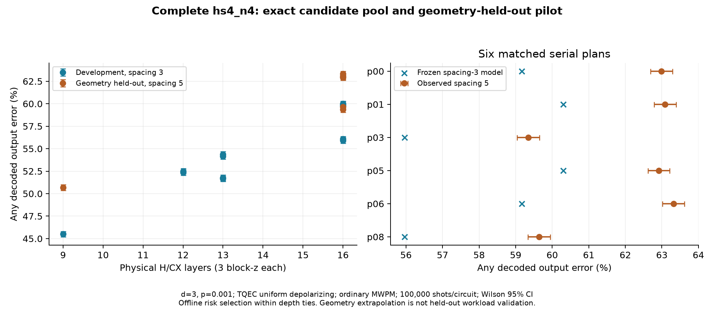

# 2026-11-02：完整公開候選池、預先凍結的風險選擇與新幾何測試

本輪將完整公開 `hs4_n4` 從四組控制擴成指定 H-ready-first 政策下的 **13 種完整合法候選**，並完成開發校準、測試前凍結、同來源新幾何測試及等待特徵／保守切換 ablation。全部 H、X、CX、量測、classical destinations 及 dependencies 保留。方法與文獻界線見 [候選規格](../PUBLIC_CANDIDATE_SELECTOR_SPEC_ZH.md)。

這一輪涵蓋 **20 個不同完整電路**：spacing3 的 13 個開發候選、spacing5 的 7 個預定測試條件。新增抽樣的完整電路為 17 個，**新 shots=1,700,000**；三份既有 spacing3 完整電路重用 300,000 shots，未重複計入新增量。Spacing5 的邏輯候選池為 13，實際編譯／取樣覆蓋 7/13（所有六個等深度串行及唯一最淺並行），沒有宣稱其餘六份也完成物理驗證。完整公開來源覆蓋仍為 1/7。

## 最重要的結果

在六個等深度串行控制中，凍結的等待特徵模型預先選 `p03`；固定 ID 基準為 `p00`。新幾何 spacing5 的完整解碼錯誤率由 **62.990% 降為 59.348%**，差值 **-3.642 個百分點，Newcombe95 CI [-4.069, -3.215]**。兩者均使用 1068 個 physical qubits、4 CX steps、12 H layers、48 block-z、1112 Stim TICKs，data reservation=192 block-z、ancilla reservation=108 block-z、總 protected idle=108 block-z。不同的是完整操作配置；不能單獨將差異歸因為純 idle。

**這是受限控制池的幾何 held-out 結果，不是 unseen-workload，也不是優於最佳並行排程的證據。** 全池只有一個最少 physical layers 的 `p12`，所有方法共同選它，測得 50.678%；因此本輪對全候選池的額外風險方法收益為 0。保守版本亦因預測差距不足而保留 `p00`，持平結果保留，沒有在看到結果後放鬆門檻。



指標是完整公開任務的四個獨立 Z-correlation observables 任一解碼錯誤，對此確定性輸出及可逆 readout mapping 等價於任一 corrected classical output bit 錯誤；不是 state/process fidelity。全部 d=3、physical p=0.001、固定 TQEC uniform-depolarizing circuit noise、普通 uncorrelated PyMatching MWPM、decomposed DEM、無 postselection，每個不同完整電路 100,000 shots。單一率為 Wilson95，差值為探索性逐項 Newcombe95，沒有 familywise 校正。

## 獨立測試的全部原始 counts

| ID | CX / H layers | block-z | QEC rounds | TICKs | Qubits | 錯誤 / shots | 錯誤率與 Wilson95 CI |
|---|---|---:|---|---:|---:|---|---|
| [p00](../../results/public_candidates_2026-11-02/samples/sample_c38ab4b3846a207f2d445a4ac932cc528d22702a7c5006218cfabf1321c297e3.json) | 4 / 12 | 48 | 未推算 | 1112 | 1068 | 62990/100000 | 62.990% [62.690, 63.289] |
| [p01](../../results/public_candidates_2026-11-02/samples/sample_a6307303fe4a3865e63dfd31b9c2292a87c8e1254b227d00e26af97411360865.json) | 4 / 12 | 48 | 未推算 | 1112 | 1068 | 63088/100000 | 63.088% [62.788, 63.387] |
| [p03](../../results/public_candidates_2026-11-02/samples/sample_eaaaf8ef0e4d5f919c1c8afc3077ff1288b02c55fc53c90bfbc40b8ee94db889.json) | 4 / 12 | 48 | 未推算 | 1112 | 1068 | 59348/100000 | 59.348% [59.043, 59.652] |
| [p05](../../results/public_candidates_2026-11-02/samples/sample_5244275c0368470fd99e3bd9a5c47b999a0a4027917d202aee5168ade6cd68b7.json) | 4 / 12 | 48 | 未推算 | 1112 | 1068 | 62917/100000 | 62.917% [62.617, 63.216] |
| [p06](../../results/public_candidates_2026-11-02/samples/sample_720c87e245071e37d1a0cba837d4d34048654d27a436fe45f3a66b8af1970369.json) | 4 / 12 | 48 | 未推算 | 1112 | 1068 | 63319/100000 | 63.319% [63.020, 63.617] |
| [p08](../../results/public_candidates_2026-11-02/samples/sample_0c36d96400897ff3ef683880bb4d4dcd55a349174c8449da275f47b036fe0a94.json) | 4 / 12 | 48 | 未推算 | 1112 | 1068 | 59645/100000 | 59.645% [59.341, 59.949] |
| [p12](../../results/public_candidates_2026-11-02/samples/sample_445b9e8f5cc5e3ebac3008b0438fb89425a8724bc9f1655cee8f7c3785d30cdd.json) | 2 / 7 | 27 | 未推算 | 636 | 1068 | 50678/100000 | 50.678% [50.368, 50.988] |

每個 raw record 均含完整 ideal/noisy/DEM SHA-256、seed、batch counts 及 noise/decoder IDs；raw circuits/DEMs 由固定快照還原。未取樣的六個 spacing5 候選沒有填補或推估成實測數字。

## Ablation：先固定規則，再看測試

| 方法 | 全池選擇 / 對基準差值 | 等深度池選擇 | 對 p00 差值（百分點） | 差值95 CI |
|---|---|---|---:|---|
| 僅深度（固定 ID tie-break） | p12 / 0 | p00 | +0.000 | [+0.000, +0.000] |
| 深度＋CX 間隔特徵 | p12 / 0 | p03 | -3.642 | [-4.069, -3.215] |
| 再加經驗敏感度切換規則 | p12 / 0 | p00 | +0.000 | [+0.000, +0.000] |

相同方法選到同一個完整電路時共用同一份 counts，差值恆為 0，沒有把同一份資料當成多次獨立成功。固定 ID 及 depth-only ridge 在同深度候選中等價；所有版本共用 13 候選與完整 footprint／feature 建立流程，對兩個比較池分別計分。

本輪迴歸預先固定 lambda=1、標準化 physical layers 與同對 CX separation 平方和、add-half logit(any-error)。僅使用 spacing3 全 13 候選校準；沒有搜尋超參數或利用 spacing5 counts 調整。由逐候選留一取得最大絕對 logit residual=0.09218149，切換門檻為兩倍=0.18436298；模型對 p00→p03 的預測 margin=0.13138784，故保守版不改選。此範圍是開發資料的敏感度估計，**不是預測 CI／coverage 保證**。

凍結檔案與選擇紀錄在 spacing5 編譯／取樣前提交，原始本地 commit=`e30cc1dc89a1c5f21e5b6078dff5c340934850db`，凍結檔 SHA-256=`72ba71afb745f8943d7db133eed55bb0e33abb7984bab53ed57e918ef4509a30`；其精確 Git 物件封存於 [pre-test bundle](../../archives/public_candidates_pretest_2026-11-02.bundle)。GitHub 連線工具的分支發布 commit 與此本地原始 commit 不同；`restore_results.py` 會先核對 bundle hash，只匯入證據物件、不移動任何工作分支，再還原 raw results。`heldout_start.json` 記錄實際凍結 SHA／開始時的原始 commit，report audit 會比對。

Spacing5 已完成這一輪測試。後續如修改模型，不能再把它當成同一輪未見資料，必須另定開發／測試分割。

## 開發校準的完整候選（非 held-out）

| ID | CX layer operation IDs | Physical layers | CX separation 平方和 | 錯誤 / shots | TICKs | 新／重用 |
|---|---|---:|---:|---|---:|---|
| p00 | `[[8], [9], [20], [21]]` | 16 | 765 | [59794/100000](../../results/public_candidates_2026-11-02/samples/sample_6dc5cea34bd8787ab736292ca710f958ea1ae609e37ae9ef8acd3adcb4a9d05e.json) | 1112 | 重用 |
| p01 | `[[8], [9], [21], [20]]` | 16 | 981 | [59727/100000](../../results/public_candidates_2026-11-02/samples/sample_50082f3e22eecb98fca4ecaa89d8db47eef96f9bfc6344ca8d7d2f0485218fd2.json) | 1112 | 新 |
| p02 | `[[8], [9], [20, 21]]` | 13 | 522 | [54358/100000](../../results/public_candidates_2026-11-02/samples/sample_34c3830e6c65cdf22744fe01f5d0252a76ff5cdd32380abd9d2d29cf5870f56c.json) | 909 | 新 |
| p03 | `[[8], [20], [9], [21]]` | 16 | 162 | [55919/100000](../../results/public_candidates_2026-11-02/samples/sample_c8dc96457db44d238549250884f920f590d711629116859a0c8ab64984a49c87.json) | 1112 | 新 |
| p04 | `[[8], [9, 20], [21]]` | 13 | 162 | [51757/100000](../../results/public_candidates_2026-11-02/samples/sample_f4bc3d304b8a378930e6fe3d06ef1b50dad03953402ba81d7aba9e074ca14107.json) | 909 | 新 |
| p05 | `[[9], [8], [20], [21]]` | 16 | 981 | [59937/100000](../../results/public_candidates_2026-11-02/samples/sample_7d84dd1fc8f786b348991eb6e08c4cde65ba164dffc5140ea120134249ef457d.json) | 1112 | 新 |
| p06 | `[[9], [8], [21], [20]]` | 16 | 765 | [60003/100000](../../results/public_candidates_2026-11-02/samples/sample_baa13d86b918da045124e98caed6f26ca59a783fc91cc522430e06ecea20cce6.json) | 1112 | 新 |
| p07 | `[[9], [8], [20, 21]]` | 13 | 522 | [54164/100000](../../results/public_candidates_2026-11-02/samples/sample_f30ec9dd44953a4e1971bff1dc57f052ea77b102101673c5ff6300123ab00688.json) | 909 | 新 |
| p08 | `[[9], [21], [8], [20]]` | 16 | 162 | [56074/100000](../../results/public_candidates_2026-11-02/samples/sample_16d2dc4a4793e2173d6bd2936d503ef7d91824a8a74233de7286afa578f6d34f.json) | 1112 | 重用 |
| p09 | `[[9], [8, 21], [20]]` | 13 | 162 | [51669/100000](../../results/public_candidates_2026-11-02/samples/sample_ef9f787041050be281e0a13dd43ec12efd2130fb4e9f0e4de60e0f73d4bc1bce.json) | 909 | 新 |
| p10 | `[[8, 9], [20], [21]]` | 12 | 405 | [52356/100000](../../results/public_candidates_2026-11-02/samples/sample_4ff9e3f6d19ad65d21de226e7096ae9db7653220a8f8c7e8fff8590064546971.json) | 839 | 新 |
| p11 | `[[8, 9], [21], [20]]` | 12 | 405 | [52495/100000](../../results/public_candidates_2026-11-02/samples/sample_50d2489632e43d8c145409bb5dcd73c768f6c685d4eb70f8d720a9f6c6208ba8.json) | 839 | 新 |
| p12 | `[[8, 9], [20, 21]]` | 9 | 162 | [45506/100000](../../results/public_candidates_2026-11-02/samples/sample_70a458e34bcd6030dba418d421cf9ac2cae8078b26913581dfacdf85cc32f222.json) | 636 | 重用 |

## 這一輪學到的邊界

1. **同總量仍能有配置差異。** 六個串行候選的全部 data/ancilla 保留總量相同；固定深度與這些總量不足以唯一決定完整解碼風險。CX separation 包含中間的 H，不能解讀成「只量到等待的因果影響」。
2. **排序有訊號，不等於絕對機率已校準。** Spacing3 模型在 spacing5 低估絕對錯誤率；沒有用測試資料平移預測。Footprint 成本在本輪單一開發幾何內為常數，不能估出幾何成本係數。下一輪需多幾何校準和新 workload 測試。
3. **更保守也有機會成本。** 本輪保守切換未換序，實測持平；這不是安全性定理。保留此 ablation，不能只展示無 guard 的改善。
4. **這個公開來源的全池主比較沒有額外決策空間。** 原 one-step／two-step／作者政策之同候選、同計算預算與獨立 routing timing 不由這些離線控制取代。

## 驗證、計時與重現

所有 20 份完整電路條件均有 16 種 signed Z inputs、四種 final logical faults、完整 observable rank／原 classical outputs，以及四個 conjugate-X generator 的物理檢查；新電路各自重做驗證，三份重用條件核對原完整 validation 與 exact hashes。每個 benchmark noisy circuit 的 shortest graphlike logical error 為 3。這是指定 graphlike 模型的距離檢查，不是任意噪聲的一般距離定理。Audit 另核對 320 份 signed classical-output mappings、所有 batch counts／CI、開發限定的重新擬合、測試前 commit 與選擇紀錄、重用／新 shots 分帳。

時間單位逐欄保留：每個 H/CX physical layer=3 block-z；X 是零時間 Pauli frame，readout 延至共同終端。Stim TICKs 由完整 compiler 直接取得；總 QEC rounds 未推算。

獨立 selector-only 計時在所有本地物理工作與首輪完整測試結束後執行，3 warmups、25 repetitions，包含完整 13 候選列舉、footprint 驗證、feature 建立與兩池選擇，排除開發校準、編譯、Monte Carlo 和 MWPM。此後只修正報表標籤及加回歸測試，沒有修改 selector；不將此離線耗時與舊 Phase1 DASCOT routing 耗時混用。主機可能共享，以下小差異不構成效能勝負。

| 方法 | 中位時間 ms |
|---|---:|
| 僅深度（固定 ID tie-break） | 2.633 |
| 深度＋CX 間隔特徵 | 2.382 |
| 再加經驗敏感度切換規則 | 2.378 |

```bash
python restore_results.py
python report_public_candidates.py
python -m pytest tests -q
# 新實驗使用新目錄；凍結結果不可覆寫：
python run_public_candidates.py development --output results_fresh/public_candidates
# 先保留本輪 development_summary 與 frozen_selection.json 的 Git 證據；再啟動測試：
git add -f results_fresh/public_candidates/frozen_selection.json
git commit -m "Freeze new independent candidate decisions"
python run_public_candidates.py heldout --output results_fresh/public_candidates
```

測試前凍結的 commit 檢查不會移動分支或推送遠端；上面重新取樣的本地 commit 是為保留方法證據。固定結果／raw circuits／DEMs 在 `archives/public_candidates_2026-11-02.zip`，source／結果 byte hashes 在 `artifact_manifest.json`，archive／pretest bundle hashes 在 `archives/manifest.json`。

首輪完整套件 113 項通過；修正報表「區間方法欄位覆蓋策略名稱」後新增回歸檢查，數據與決策未變。最終測試與獨立重播結果以 `docs/validation/public_candidates_tests_final.log`、`docs/validation/public_candidates_replay.json` 及對應 GitHub Actions 為準。

## 發布狀態、剩餘必要工作與下一步

本輪成果保存在 `research/2026-11-02-public-risk-pilot`。自動審核拒絕直接推送共享 main，原因是需要明確分支授權；另一路 git CLI 缺推送認證，因此改用已連接的 GitHub 工具保存到獨立分支。**main 尚未更新**，沒有建立 issues/comments 或聯絡其他人。原始 pretest Git 物件已隨分支保留，不將重建的發布 commit 混稱測試前 commit。

**μ 保持 0；本輪是離線候選選擇 pilot。** 已完成一份完整公開來源、完整解碼、新幾何測試與等待／guard ablation；尚需將原 original／one-step／two-step 共用候選／計算預算接入、做跨 workload held-out、多幾何 footprint／風險校準及更完整文獻差異驗證。各項保留，沒有因提前交付而刪除。

正式英文 PPTX/PDF、分開中文可朗讀講稿、詳細理解補充、問答及最終固定快照仍以 **11/5 23:59 Asia/Taipei 前完成**；11/6–11/8 留給演練與明確回饋。TQEC 提供原 H/CNOT 設計、correlation machinery、composition 及 physical compiler；QASMBench 提供來源；Stim／PyMatching 提供抽樣與解碼。本輪新增的是完整候選列舉、可追溯配置特徵、固定校準／凍結決策、離線候選 ablation、完整物理驗證與科學紀錄。
