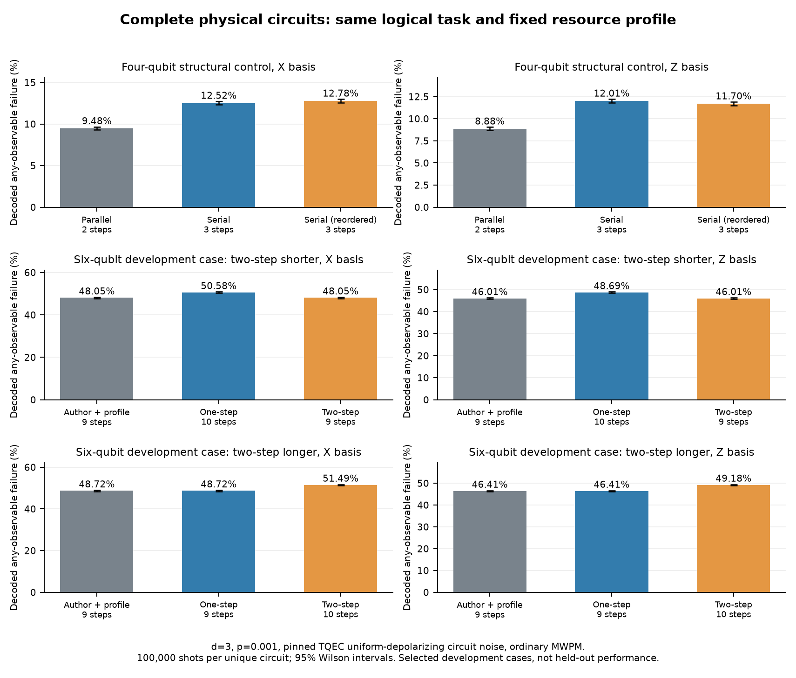

# 2026-11-02：不同合法排程接通完整物理電路，保留正反案例

## 新增能力與本次範圍

現在可以把**同一批 CNOT 的不同合法順序／並行排程**，編成含完整等待保護的物理電路，再一起抽樣與解碼。先前兩個相依 CNOT 模板沒有排程選擇；這次擴充為固定 diagonal profile、2–6 個存活邏輯位元、forward CNOT、L 形橋接及並行 layer。以下實驗固定 x spacing=1、d=3、X/Z basis、p=0.001。

本次有 **9 份來源排程、18 份物理請求、14 個不同的完整電路，共新增 1,400,000 noisy shots**。完全相同的 ideal/noisy hash 才重用完整電路 counts；不是每份請求都另算 100,000 shots。每個不同電路另做全部 2^n 輸入符號、n 種 final logical fault、輸入／輸出 observable rank 與 graphlike distance=3 檢查。

兩組六位元案例是**開發 fixture**，由固定 seed=204 的搜尋，在第 4 與第 34 個候選找到第一個 two-step 較長／較短的例子；一共檢視 35 個候選，在任何 noisy sampling 前固定。兩個方向都保留。這批驗證閉環與邊界，不能用其勝率宣稱 held-out 演算法表現。公開 benchmark 的完整整合仍保留為必要後續工作。



## 完整結果

指標是完整、獨立的 n 個 basis-specific correlation observables 任一解碼錯誤；不是 state/process fidelity。Noise 為固定 TQEC uniform-depolarizing circuit model，decoder 為普通 uncorrelated PyMatching MWPM；不做 postselection。不同任務與不同 basis 的率不直接相減比較。

| 任務 | Basis | 排程 | Steps | TICKs | Qubits | 錯誤／shots | 錯誤率與 95% Wilson CI |
|---|---|---|---:|---:|---:|---:|---|
| 四位元控制 | X | Parallel | 2 | 146 | 193 | 9480/100000 | 9.480% [9.300, 9.663] |
| 四位元控制 | Z | Parallel | 2 | 146 | 193 | 8876/100000 | 8.876% [8.701, 9.054] |
| 四位元控制 | X | Serial | 3 | 209 | 193 | 12515/100000 | 12.515% [12.311, 12.722] |
| 四位元控制 | Z | Serial | 3 | 209 | 193 | 12005/100000 | 12.005% [11.805, 12.208] |
| 四位元控制 | X | Serial (reordered) | 3 | 209 | 193 | 12778/100000 | 12.778% [12.573, 12.986] |
| 四位元控制 | Z | Serial (reordered) | 3 | 209 | 193 | 11695/100000 | 11.695% [11.497, 11.896] |
| 開發：two 較短 | X | Author + profile | 9 | 587 | 575 | 48054/100000 | 48.054% [47.744, 48.364] |
| 開發：two 較短 | Z | Author + profile | 9 | 587 | 575 | 46013/100000 | 46.013% [45.704, 46.322] |
| 開發：two 較短 | X | One-step | 10 | 650 | 575 | 50582/100000 | 50.582% [50.272, 50.892] |
| 開發：two 較短 | Z | One-step | 10 | 650 | 575 | 48694/100000 | 48.694% [48.384, 49.004] |
| 開發：two 較短 | X | Two-step | 9 | 587 | 575 | 48054/100000 | 48.054% [47.744, 48.364] |
| 開發：two 較短 | Z | Two-step | 9 | 587 | 575 | 46013/100000 | 46.013% [45.704, 46.322] |
| 開發：two 較長 | X | Author + profile | 9 | 587 | 603 | 48720/100000 | 48.720% [48.410, 49.030] |
| 開發：two 較長 | Z | Author + profile | 9 | 587 | 603 | 46408/100000 | 46.408% [46.099, 46.717] |
| 開發：two 較長 | X | One-step | 9 | 587 | 603 | 48720/100000 | 48.720% [48.410, 49.030] |
| 開發：two 較長 | Z | One-step | 9 | 587 | 603 | 46408/100000 | 46.408% [46.099, 46.717] |
| 開發：two 較長 | X | Two-step | 10 | 650 | 603 | 51492/100000 | 51.492% [51.182, 51.802] |
| 開發：two 較長 | Z | Two-step | 10 | 650 | 603 | 49183/100000 | 49.183% [48.873, 49.493] |

`Author + profile` 使用固定版本作者的搜尋政策，替換成與我們相同的保守資源保留 primitive；**不是未修改的 DASCOT 原方法**。One-step 與 two-step 皆最多每步 48 個 front evaluations、同 cap=16；小 front 可能先耗盡所有 permutations，預算不一定用滿。實際候選與成本逐步保存在 source_routes。

## 差值與可作出的結論

下表單位為**百分點**，第二種方法減第一種。不同電路採獨立 binomial 樣本的 [Newcombe (1998) score interval](https://pubmed.ncbi.nlm.nih.gov/9595617/)；相同完整電路重用樣本時，差值在這份比較中恆為 0。區間為探索性、逐項 95%，沒有對全部比較作 familywise 校正。

| 任務 | Basis | 比較方向 | 差值（百分點） | 差值 95% CI |
|---|---|---|---:|---|
| 四位元控制 | X | Serial − Parallel | +3.035 | [+2.761, +3.309] |
| 四位元控制 | X | Serial (reordered) − Parallel | +3.298 | [+3.023, +3.573] |
| 四位元控制 | X | Serial (reordered) − Serial | +0.263 | [-0.028, +0.554] |
| 四位元控制 | Z | Serial − Parallel | +3.129 | [+2.861, +3.397] |
| 四位元控制 | Z | Serial (reordered) − Parallel | +2.819 | [+2.553, +3.085] |
| 四位元控制 | Z | Serial (reordered) − Serial | -0.310 | [-0.593, -0.027] |
| 開發：two 較短 | X | Two-step − One-step | -2.528 | [-2.966, -2.090] |
| 開發：two 較短 | X | Two-step − Author + profile | +0.000 | [+0.000, +0.000] |
| 開發：two 較短 | Z | Two-step − One-step | -2.681 | [-3.118, -2.243] |
| 開發：two 較短 | Z | Two-step − Author + profile | +0.000 | [+0.000, +0.000] |
| 開發：two 較長 | X | Two-step − One-step | +2.772 | [+2.334, +3.210] |
| 開發：two 較長 | X | Two-step − Author + profile | +2.772 | [+2.334, +3.210] |
| 開發：two 較長 | Z | Two-step − One-step | +2.775 | [+2.337, +3.213] |
| 開發：two 較長 | Z | Two-step − Author + profile | +2.775 | [+2.337, +3.213] |

四位元控制的完整工作是 CNOT(0,1)、CNOT(2,3)、CNOT(1,2)：前兩個可以平行，也可合法換序。它提供排程／等待差異的機制比較，串行版本是顯式控制組，不是宣稱 one-step 只能串行。六位元正反例則直接使用我們的 scheduler 輸出，展示多看一步仍有邊界；作者政策亦可能達到相同排程。單一開發例子的改善不等於普遍優於作者方法。

## 時間、資源與等待

每個 source step 在本 profile 佔 3 個 block-z。TICKs 來自實際 compiler，沒有使用 1 step=1 TICK 的假設。所有資料 patch 從 z=0 同時存在到共同輸出；每一段 temporal pipe 都檢查存在。每個 CNOT 的完整 data/ancilla footprint 在整個 layer 保守保留，不能只看一條細路徑。

同一 case 的 layout、全部 gates、輸入／輸出條件、可用晶片資源與 noise／decoder 固定，允許用不同平行度使用這些資源。`data_reservation_block_z`、ancilla 保留量、逐 qubit active/memory layers、逐 gate 時間與實際 qubits 均保存。等深度且全部狀態同壽命時，總 memory volume 可能相同，不能預設任何等待特徵都能區分風險。

## 搜尋成本

先完成獨立 routing-only 計時，再開始編譯與 Monte Carlo。每項 3 次 warmup、25 次重複；下表為中位數。這是小型受限 profile 的計時，不能當成 Phase 1 較大電路的成本比值；主機可能共享。

| 任務 | 方法 | 中位 routing ms | 重複 |
|---|---|---:|---:|
| 開發：two 較短 | Author + profile | 0.211 | 25 |
| 開發：two 較短 | One-step | 0.250 | 25 |
| 開發：two 較短 | Two-step | 0.270 | 25 |
| 開發：two 較長 | Author + profile | 0.242 | 25 |
| 開發：two 較長 | One-step | 0.232 | 25 |
| 開發：two 較長 | Two-step | 0.290 | 25 |

## 驗證發現：observable 數量正確，rank 仍可能不完整

固定版本的上游 finder 會將互不連通區塊的 correlation generators 作跨區塊組合。對兩個獨立 CNOT，直接取得四個跨區塊乘積時，輸入 rank 可能只有 3；僅檢查「有四個 observables」或每一個單獨 final fault，仍不足以保證完整基底。

本次在 adapter 中逐 connected component 取得 generators，再把聯集交給原 physical compiler；輸入及輸出 rank 都必須等於 n。這不改動上游程式，也不把問題擴大宣稱為所有 TQEC 情況的缺陷。回歸測試涵蓋獨立並行區塊、從未參與 gate 的 spectator、較長的 y arm、共同生命週期，以及不合法順序／重疊 footprint／不支援欄位的拒絕。

## 公開 benchmark 與內容完整性

已保存七份完整 QASMBench 原始碼、license/notice、固定 commit、Git blob SHA 與 SHA-256，並展開自訂 gate、保留量測與 classical dependencies 建立 DAG。下表的可換序配對是 DAG 中互不可達的 CX 對；它不同於某一組 ASAP fronts 裡同時 ready 的 CX 數。

| 公開電路 | 邏輯位元 | CX 數 | 互不可達的 CX 配對 | 靜態 Clifford |
|---|---:|---:|---:|---|
| qec_sm_n5 | 5 | 4 | 0 | 含非 Clifford／動態條件 |
| qec_en_n5 | 5 | 10 | 0 | 含非 Clifford／動態條件 |
| cat_state_n4 | 4 | 3 | 0 | 是 |
| error_correctiond3_n5 | 5 | 49 | 3 | 是 |
| hs4_n4 | 4 | 4 | 4 | 是 |
| bell_n4 | 4 | 7 | 9 | 含非 Clifford／動態條件 |
| simon_n6 | 6 | 2 | 0 | 含非 Clifford／動態條件 |

優先整合目標為完整 `hs4_n4`：4 CX、20 H、4 X、4 次量測，含可獨立排程的 CX。現有純 CNOT backend 尚未處理其全部單位元閘，因此完整 physical support 為 **0/7**；沒有刪掉 H/X 來製造支援。`error_correctiond3_n5` 亦有被不同 ASAP 時刻掩蓋的合法換序機會，保留為後續候選。

使用者要求「天數壓縮，內容不壓縮」：完整公開 workload、公平比較與計時、trade-off、風險方法的校準／held-out／ablation／文獻比較，以及全部報告材料均繼續推進。這次完成其中的並行／排程閉環與 benchmark DAG 增量，不代表整份 roadmap 已完成。Scheduler **μ 仍為 0**；尚未宣稱 risk-aware 策略改善或方法首創。

## 紀錄與重現

本次 reconciliation 通過：18 份請求、14 個完整電路、circuits/DEMs、batch counts、CI、來源 hash、certificate、observable rank 及唯一 shot 計數。電路 ID 使用 Stim 物件的 canonical 字串 hash；原始檔案的逐 byte hash 另由快照 manifest 保護。這份 audit 不新增抽樣。

```bash
python -m pytest tests -q
python restore_results.py
python report_schedule_pilot.py
python run_public_audit.py --output results_fresh/public_audit
python select_schedule_fixtures.py --output results_fresh/fixtures.json
python run_schedule_pilot.py --output results_fresh/schedule_pilot
```

Runners 拒絕覆寫既有目錄；完整新取樣使用最後一行。公開來源在 `benchmarks/public_2026-11-02/`，選樣規則／35 個試次在 `benchmarks/schedule_pilot_2026-11-02.json`；新資料在 `results/schedule_pilot_2026-11-02/`，完整相容性檢查在 `results/public_audit_2026-11-02_v2/`。快照另保留完整 raw circuits、DEMs 與紀錄；CI 狀態以本次 GitHub Actions 為準。

TQEC 提供原 CNOT 設計、correlation-surface machinery、graph composition 與 physical compiler；Stim/PyMatching 提供抽樣與解碼。新增工作是 L 形空間延伸、完整資源保留 primitive、來源排程與時間合約、component observable 基底處理、驗證、公開來源稽核及完整電路量測。QASMBench 原始電路屬其作者。
