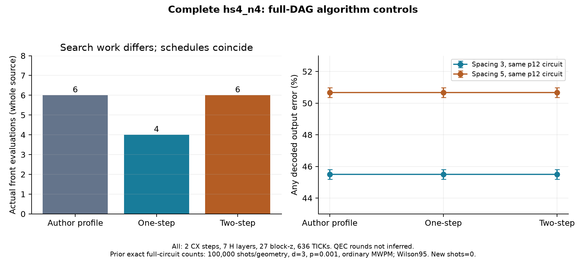

# 2026-11-03：完整公開 DAG 接回 one-step／two-step，保存先前風險 pilot

## 新增能力與意義

本次新增 `public_lookahead.py`，把既有 bounded lookahead 的 criticality-progress 規則接到**完整公開 `hs4_n4` 指令 DAG**。不是只取四個 CX：全部 20 H、4 X、4 CX、4 次原始量測及 classical destinations／dependencies 仍逐項保留。來源 SHA-256 為 `f362ca9ffd7f045f517dfe4d67350794ac998f4eb427586a804eed9379340f63`，來源 commit／原檔／license 與 [前一輪完整整合](2026-11-02-public-hs4.md)相同。

每次 CX 決策前，先處理 ready 的 virtual X／延後量測與 H-ready-first closure。Two-step rollout 在候選執行後也走過相同 closure，更新每個 patch 的邊界方向，再對下一個 CX front 檢查**完整 data／ancilla footprint**。Rollout 不會跳過 H，H 的實體時間也保留在最終電路；不把 H 當 T gate 或零時間的實體操作。

這是原評分規則在新物理 profile／完整 DAG 下的受限適配；不等於把舊作者 router 原封不動用於任意 H/X/CX 電路。作者參考組直接呼叫 pinned wisq `best_realizable_set_found`，只替換 route-order primitive 為相同 oriented-footprint primitive，並採相同完整 DAG closure。原 Phase1 的未改作者 baseline 與大型 routing 結果另外保留。

## 同候選／同上限預算比較

方法含 `author_profile`、`one_budget48`、`two_budget48`、`one_pool16`、`two_pool16`；兩種幾何 spacing3／5 × seeds 1／2／3，共 **30 組來源設定**。

- 同預算組：one-step／two-step 每個 CX front 的 route-order 評估上限均為 48，rollout 的額外 front 評估也計入。
- 同候選池組：兩者候選上限均為 16、評估上限均為 48，使用相同 `lookahead.candidate_orders` 與 state seed。此次實際來源狀態／評估 order pools 逐 front 相同，另保存六份配對檢查。
- 相同上限不等於實際工作相等：此次 front 小，只有兩個排列，候選空間先飽和。保留實際 front、gate-route 及 closure 計數和獨立時間，不用額外重複工作湊滿預算。
- 作者搜尋是另列的參考組，實際呼叫量照計，**不是同預算／同候選池控制**。它在這份小 front 中使用上游完整排列搜尋分支。

Criticality 為完整 quantum/classical DAG 上的剩餘 CX 最長鏈（H/X/readout 的權重為 0，但相依關係保留）。One-step 評估本次 CX criticality 總和；two-step 加上 closure 後 greedy rollout 的 CX criticality 總和。這是「下一個 CX 決策」的 horizon，**不是固定兩個 physical layers**；H duration 目前不是 progress score 的一項，將此邊界明列而不稱時間最優解。未讀取任何 noisy labels，`mu=0`。

## 實測結果：本公開案例上全部持平

全部方法／seeds 均選到既有 `p12` 並行排程：**2 CX steps、7 H layers、27 template block-z、636 Stim TICKs**。X 為零時間 Pauli frame；全部 live patches 保留到共同終端讀出。QEC rounds 明列 null／未推算，沒有與 routing steps、block-z 或 TICK 混用。

| 幾何 | 所有方法的完整電路 | Physical qubits | 錯誤／shots（重用） | Any-error 與 Wilson95 CI |
|---|---|---:|---|---|
| spacing3 | [p12 raw record](../../results/public_candidates_2026-11-02/samples/sample_70a458e34bcd6030dba418d421cf9ac2cae8078b26913581dfacdf85cc32f222.json) | 620 | 45506／100000 | 45.506% [45.198%, 45.815%] |
| spacing5 | [p12 raw record](../../results/public_candidates_2026-11-02/samples/sample_445b9e8f5cc5e3ebac3008b0438fb89425a8724bc9f1655cee8f7c3785d30cdd.json) | 1068 | 50678／100000 | 50.678% [50.368%, 50.988%] |

條件：d=3、physical p=0.001、TQEC uniform-depolarizing circuit noise（`tqec_uniform_depolarizing_circuit_v1`）、普通 uncorrelated PyMatching MWPM／decomposed DEM（`pymatching_ordinary_uncorrelated_mwpm_decomposed_dem`）、無 postselection。指標是完整來源四個獨立 Z-correlation observables 任一解碼錯誤；此來源的可逆 readout map 可對應原始 corrected classical bits，**不是 fidelity**。

今天新增 **0 noisy shots**。30 個方法設定只對應兩個完整物理電路；每個電路共用一份既有 100,000-shot record，不能乘上方法數或 seed 數當新增抽樣。各方法同幾何的差值恆為 0，因為比較的是**完全同一個電路／同份 counts**，不是三次獨立 Monte Carlo 成功。兩個幾何的資源不同，不將跨幾何差值當固定資源的演算法勝負。

| 方法 | 全來源實際 front 評估 | gate-route 檢查 | 額外 rollout closure 評估 |
|---|---:|---:|---:|
| 作者受限策略 | 6 | 12 | 0 |
| One-step（兩種 budget/pool 設定均同） | 4 | 8 | 0 |
| Two-step（兩種 budget/pool 設定均同） | 6 | 12 | 4 |

這份來源沒有顯示 lookahead 的額外效益，也不能把先前刻意串行的控制組標成 one-step 的自然結果。這次整合排除了那種錯誤比較；大型 Phase1 的改善與物理開發 fixture 的正反例仍依各自實證範圍呈現。



## 驗證與獨立計時

兩種不同輸出都重新編譯完整電路，核對 ideal／noisy／DEM SHA-256 與既有原始紀錄完全一致；再檢查全部 16 種 signed Z inputs、四種 final logical faults、完整 source tableau／Pauli frame，shortest graphlike logical error 均為 3。原有四個 conjugate-X generator 的物理驗證只在 exact full-circuit identity 下重用，不假裝今天又跑一次。新編譯驗證耗時與 routing 時間分開保存。

**本次完整套件 120 項通過（305.99 秒）。** 新測試涵蓋完整來源、方向與 H closure、真實 footprint 衝突、每 front 預算、固定候選池、可重現性／狀態與 RNG 隔離、錯誤設定拒絕。完整套件與重播證據見 [本次完整測試紀錄](../validation/2026-11-03-full-tests.log)、[先前 risk pilot 重播](../validation/public_candidates_replay.json)及 [本次 record audit](../../results/public_lookahead_2026-11-03/record_audit.json)。

獨立 routing 計時在所有 physical replay 與完整測試結束後執行：3 warmups、25 repetitions，輪替方法順序；不含 compiler、Monte Carlo、MWPM、開發校準或離線完整候選列舉。計入完整 DAG 排程、候選產生、完整 footprint、closure 與 score。共享主機的小時間差只描述成本，不作顯著性宣稱。原始每次時間另存 `routing_timing_isolated.json`。

| 方法 | 六個 geometry/seed 設定之中位 routing 時間（ms） |
|---|---:|
| author_profile | 0.401 |
| one_budget48 | 0.183 |
| two_budget48 | 0.286 |
| one_pool16 | 0.183 |
| two_pool16 | 0.271 |


另在全新 Git clone 成功還原 8 份封存並重播兩份 report，稽核均通過；見 [乾淨重播紀錄](../validation/2026-11-03-clean-replay.json)。沒有依賴原工作區的未追蹤 raw circuits。

## 恢復與完成先前尚未完整發布的成果

本次先比較遠端與所有保留工作區，發現研究分支已有開發校準／凍結決策，而另一個本地 checkout 保存完整 spacing5 測試、snapshot、圖表及說明。將其當成**既有證據恢復及核對**，不是今天新完成 170 萬 shots。已成功重新執行 `restore_results.py` 與 `report_public_candidates.py`：20 個完整電路、320 份 signed classical-output checks、開發限定擬合、pre-test commit／bundle、全部 raw hashes／counts／CI／新舊 shots 分帳均通過。

[完整風險 pilot 與 ablation](2026-11-02-risk-pilot.md)的結論不變：等深度控制池 `p00→p03` 在當時凍結後的 spacing5 測試下降 **3.642 個百分點，Newcombe95 CI [-4.069, -3.215]**；全池都選 p12、額外收益為 0；保守版本維持 p00、收益也為 0。這是單一公開來源的新幾何測試，不是跨 workload 證據，spacing5 現在已被觀察，後續不能再冒稱新 held-out。

## 狀態、下一步與不可刪除的交付

- 完整公開來源物理覆蓋仍為 **1/7**；本次是該完整來源的公平演算法整合，沒有增加來源覆蓋數。
- 新幾何風險 pilot／ablation 已核對；**跨 workload held-out、多幾何 footprint／絕對風險校準，以及將風險模型放進有實際平手選擇的 online candidate 決策**仍未完成。新 full-DAG adapter 的 two-step 目前沒有額外風險評分，`mu=0`。
- 下一個研究增量優先補上第二個有多種排程選擇的完整公開 Clifford workload，先固定完整來源、編譯／observable 支援和未見測試規格，再做風險整合與 held-out；保留 S/Sdg／非 Clifford／動態回授等具體拒絕原因，不能刪 gate 冒充完整來源。
- 11/4 仍須完成必要對照、幾何／等待／資源分析、校準／獨立測試／ablation 與文獻差異，11/5 23:59 前交付英文 PPTX/PDF、中文講稿、理解補充、問答和固定可重現快照。**天數壓縮，內容不壓縮；未完成項目不勾選完成，也不推遲到 11/6–11/8。**

發布沿用 `research/2026-11-02-public-risk-pilot`，不覆寫 main 或組員修改；分支含先前 risk pilot 的完整 raw snapshot，及今天的新程式、30 份 route records、compile replays、計時與稽核。Git CLI 推送缺少認證，使用已連接的 GitHub 工具保存分支；以最終 commit 與 Actions 實際狀態為準。

TQEC 提供原 H/CNOT 模板、graph composition、correlation surfaces 與 physical compiler；wisq/DASCOT 提供作者搜尋；Stim/PyMatching 提供抽樣／解碼。此次新增的是完整 DAG 的有方向 footprint/lookahead 適配、公平對照、完整電路重播／精確重用與可追溯成本紀錄。

## 重現

```bash
python restore_results.py
python report_public_candidates.py
python report_public_lookahead.py
python -m pytest tests -q
# 重新驗證請用新目錄，不覆寫已保存的結果：
python run_public_lookahead.py --output results_fresh/public_lookahead
# 所有 physical jobs 與 tests 結束後，再獨立計時：
python run_public_lookahead.py --output results_fresh/public_lookahead --timing
```
