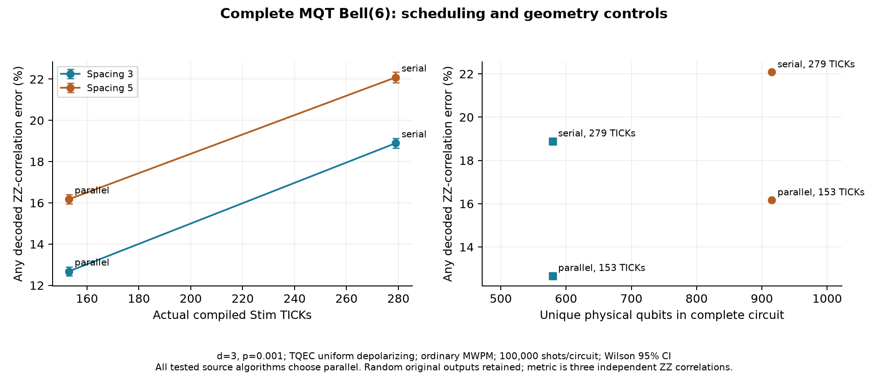

# 2026-11-04：第二份完整公開電路、隨機讀出與幾何／排程實測

## 新增了什麼、為什麼有用

完成第二份完整公開 workload：**MQT Bench 的 Bell(6)**。固定上游 [commit `8f919416`](https://github.com/munich-quantum-toolkit/bench/blob/8f919416457d76b256930443078334021634236f/src/mqt/bench/benchmarks/bell.py)，保存原始 generator、MIT license、完整生成 QASM 及各檔 SHA-256：[來源 manifest](../../benchmarks/public_2026-11-04/manifest.json)。直接執行 pinned `create_circuit(6)` 函式本體；只略過註冊 benchmark 的 decorator，沒有改函式運算、刪 gate、transpile 或 cancellation。

保留 **3 H、3 CX、1 barrier、6 次原始量測，共 13 指令**，含原始 classical destinations 與全部相依關係。三組 CX 相互獨立，完整 H-first／CX-subset 規則下有 **13 份合法排程**，因此不只是只有一條相依鏈的相容性測試。新增 barrier 的零時間同步 fence 實作；它在完整 DAG、plan 與 certificate 仍存在，不能跨越原本 dependencies。

這份公開來源的原始輸出含隨機位元。理想情況有 8 種等機率字串，每種機率 1/8，各 Bell pair 的兩個 bit 相同。**不能將每次輸出都拿去與固定 `000000` 比較，也不能套用 hs4 的可逆四位元 readout map。** 本輪的指標是完整電路上三個獨立原始 Z／ZZ-correlation observables 的任一解碼錯誤；保留全部原始 Z 量測，不是全狀態 fidelity，也不是全部個別輸出位元的錯誤率。

完整物理 source 覆蓋率由 QASMBench 的 1/7 擴至 **兩個固定來源集合的 2/8**（原七份 QASMBench＋一份 MQT 固定實例），不是把原 QASMBench 的覆蓋率改寫成 2/7。原本六份未支援來源及其拒絕原因均保留。

## 實測結果與證據

每個電路 **100,000 noisy shots**，共 **4 個不同完整電路、400,000 新 noisy shots**。固定 d=3、physical p=0.001、TQEC uniform-depolarizing circuit noise（`tqec_uniform_depolarizing_circuit_v1`）、普通 uncorrelated PyMatching MWPM／decomposed DEM（`pymatching_ordinary_uncorrelated_mwpm_decomposed_dem`），無 postselection。

| 幾何／控制 | CX routing steps | H layers | Template block-z | QEC rounds | Stim TICKs | Physical qubits | 錯誤／shots | 錯誤率與 Wilson95 CI |
|---|---:|---:|---:|---|---:|---:|---|---|
| spacing3 並行 | 1 | 1 | 6 | 未推算 | 153 | 579 | 12679／100000 | 12.679% [12.474%, 12.887%] |
| spacing3 串行 | 3 | 1 | 12 | 未推算 | 279 | 579 | 18895／100000 | 18.895% [18.654%, 19.139%] |
| spacing5 並行 | 1 | 1 | 6 | 未推算 | 153 | 915 | 16173／100000 | 16.173% [15.946%, 16.403%] |
| spacing5 串行 | 3 | 1 | 12 | 未推算 | 279 | 915 | 22086／100000 | 22.086% [21.830%, 22.344%] |

時間政策：每個實體 H／CX layer＝3 template block-z；barrier 不增加實體時間，但保留同步限制；量測在共同終端進行。TICK 直接由實際編譯電路計數，沒有假設 1 routing step＝1 QEC round＝1 TICK。H 使用 pinned TQEC 的實體建構及 realignment，不能把它當零時間操作。

並行減串行的完整解碼錯誤率差值：

| 固定幾何 | 差值（百分點） | Newcombe95 CI（百分點） |
|---|---:|---|
| spacing3 | -6.216 | [-6.534, -5.898] |
| spacing5 | -5.913 | [-6.257, -5.569] |

這些是事先固定的**並行／串行結構控制**，不是 one-step／two-step 的收益。差值區間是獨立 binomial、pointwise95，沒有聲稱多重比較 familywise coverage。跨幾何的實體資源不同，不當作固定資源的演算法勝負。



完整 [summary](../../results/public_bell_2026-11-04/summary.json)、[raw sample records](../../results/public_bell_2026-11-04/samples)、[certificate](../../results/public_bell_2026-11-04/certificates)、[差值與資源帳](../../results/public_bell_2026-11-04/evaluation.json)均保存；每份 raw record 有 ideal／noisy／DEM SHA-256、noise／decoder IDs、seed、batch size、逐批 counts、每 observable counts 及 CI。Raw Stim／DEM 在固定快照中，使用 `restore_results.py` 還原。

### 幾何、等待與資源的取捨

所有六個邏輯 patch 從共同初始化持續保護到終端，含已完成操作與尚未參與操作的狀態。不能在中間讀出重設，以節省等待成本。

| 幾何／控制 | 峰值 ancilla 保留（xy blocks） | 峰值 data＋ancilla 保留 | Data 保留量（block-z） | Ancilla 保留量（block-z） | Protected idle 總長（block-z） |
|---|---:|---:|---:|---:|---:|
| spacing3 並行 | 15 | 21 | 36 | 45 | 9 |
| spacing3 串行 | 5 | 11 | 72 | 45 | 45 |
| spacing5 並行 | 27 | 33 | 36 | 81 | 9 |
| spacing5 串行 | 9 | 15 | 72 | 81 | 45 |

同幾何的並行／串行使用相同已佈置的實體 sites（579 或 915 qubits），但並行的瞬間 ancilla 占用較多；串行雖降低峰值占用，卻讓 data 存活與等待更久。因此「固定裝置容量」「當下占用」與「space-time 保留量」不能混稱一個資源數字。

同樣 153 TICKs 的兩份並行電路，較長幾何使用更多 qubits，錯誤率也較高；同幾何下，串行增加保護期間並提高錯誤率。這是指定模型下的完整電路證據，不是孤立 gadget survival 乘積。

### 公平方法對照：新來源仍全部持平

作者受限 profile 參考、one-step／two-step 同 budget48，以及 one-step／two-step 同 pool16、budget48；兩幾何 × 三 seeds，共 **30 份來源設定**。每個 CX front 走完整 H／barrier／readout closure、有方向邊界與完整 footprint。作者是額外 unmatched-cost 參考，不冒稱與控制組計算量相同。

**所有方法都選到三組 CX 同時執行的自然排程。** 同幾何的算法對照共用完全相同的完整電路與 counts，差值恆為 0，沒有另增 30×100000 shots，也沒有把人工串行排程標成 one-step。Six fixed-pool 配對的實際 state／candidate orders 已核對。

所有 physics／tests 結束後，獨立執行 routing 計時：3 warmups、25 repetitions、輪替方法順序，計入完整 DAG、候選與 footprint／closure，排除 compiler、Monte Carlo、MWPM、離線 calibration 與完整 pool enumeration。六個 geometry／seed 設定中位數：

| 方法 | Median routing time（ms） |
|---|---:|
| 作者受限參考 | 0.219 |
| One-step budget48 | 0.129 |
| Two-step budget48 | 0.161 |
| One-step pool16 | 0.122 |
| Two-step pool16 | 0.154 |

原始每次計時在 [routing_timing_isolated.json](../../results/public_bell_2026-11-04/routing_timing_isolated.json)。共享主機的小時間差僅描述成本，不作顯著性主張。

## 驗證與可重現性

- **124 項完整本地測試通過，413.79 秒**：[完整 log](../validation/2026-11-04-full-tests.log)。預先凍結版本的 [GitHub CI 通過](https://github.com/yoyocar2333/Descot/actions/runs/41823985070)。
- 每份完整電路：全部 64 signed Z inputs、全部 **12 個 X／Z Clifford generators** 的獨立 mixed-boundary 物理檢查、6 個已知 final logical faults、完整原始 Z subgroup、原始 source statevector 的 8 種輸出及 classical mapping，以及 shortest graphlike error＝3。
- ZZ-only 指標不會驗到所有 phase／H 作用；因此不能只憑主要 readout 成功就宣稱整個 unitary 正確。每個獨立生成元另有完整 signed-input 檢查，本輪合計 **3328 組 ideal signed-boundary settings**；它們不計入 400000 noisy shots。
- [record audit](../../results/public_bell_2026-11-04/record_audit.json)核對完整指令／原始相依性、source／circuit／DEM hashes、raw batches、CI、unique shots 及事前凍結。
- 全部新 labels 之前已在 local commit `4978c9f` 固定設計；[發布版本 `d3bce22`](https://github.com/yoyocar2333/Descot/commit/d3bce22e9404eb5899a1ee9aa161361b4159d9b9)具有**完全相同 tree**。Git bundle 保留原本 local commit，以便乾淨環境驗證事前紀錄；[版本對應](../validation/2026-11-04-freeze-provenance.json)。
- **全新 GitHub clone 還原與重播通過**：9 份封存、60 份本輪 artifact hashes 全部相符；事前 local commit 在 clone 原本不存在，由 hash-verified bundle 成功恢復，沒有依賴舊工作區 cache。[乾淨重播紀錄](../validation/2026-11-04-clean-replay.json)。
- 新增 barrier／生成元支援後，也重新編譯原 hs4：ideal／noisy／DEM hashes 與既有凍結記錄完全相同，**新 shots＝0**；[相容性重播](../validation/2026-11-04-hs4-compatibility.json)。原始凍結結果未改寫。

## 風險方法、文獻與下一步

舊 hs4 的完整電路 calibration 是四位元、四個 observables；Bell 是六位元、三個 ZZ observables，且來源作用與特徵範圍不同。**本輪暫停套用舊絕對風險模型，沒有重訓後冒稱 held-out。** [事前設計與 transfer audit](../../results/public_bell_2026-11-04/frozen_design.json)保留原因；`mu=0`。

這完成第二來源的 prospective 演算法／物理控制評估，但不是「風險模型跨 workload 有效」的證明。原 hs4 新幾何 pilot／ablation 的結果繼續保留；跨 workload 目標匹配校準、風險排序 held-out，以及 online 等進度候選的風險決策仍是**必要未完成工作**。Bell 的自然決策沒有平手取捨可以展現新收益，不以這個持平結果替代那些交付。

新增 [文獻差異表](../RELATED_WORK_2026-11-04_ZH.md)，比較 DASCOT、同步政策、3D／lookahead routing、PureMagic 與近期 Patchwork。已區分實際閱讀的方法與僅核對摘要的來源，不宣稱「考慮等待」「使用 lookahead」「完整編譯解碼」為首創。

下一步保留原定全部內容：補匹配目標與支援域的跨 workload calibration／held-out、online risk 平手決策與 ablation；完成統一圖表及正式英文 PPTX／PDF、獨立中文朗讀稿、詳細理解補充、Q&A 及最終可重現快照。**截止仍為 11/5 23:59 Asia/Taipei，未將必要工作排到 11/6–11/8。** 本輪沒有把尚未完成項目勾選完成。

TQEC 提供 H／CNOT 原模板、graph composition、correlation surfaces 與物理 compiler；wisq 提供作者搜尋；MQT Bench 提供完整邏輯來源；Stim／PyMatching 提供取樣與解碼。本次新增 barrier／完整生成元驗證、完整第二來源整合、公平控制、量測與可追溯分析。

## 重現

```bash
python restore_results.py
python report_bell_benchmark.py
python -m pytest tests -q
# 使用新目錄重新實驗，不覆寫凍結結果；prepare 後先提交其設計與 source：
python run_bell_benchmark.py prepare --output results_fresh/bell
# 將 results_fresh/bell 的設計及源碼提交 Git 後：
python run_bell_benchmark.py run --output results_fresh/bell
# 全部 physical jobs／tests 結束後，才單獨計時：
python run_bell_benchmark.py timing --output results_fresh/bell
```

歷史 hs4 strict source-hash report 請在 `ba77e98574c0c7104027ff03ec56189334fc7cb7` 的獨立 checkout 還原及重播；新增功能不改寫歷史 source hashes 或凍結結果。
