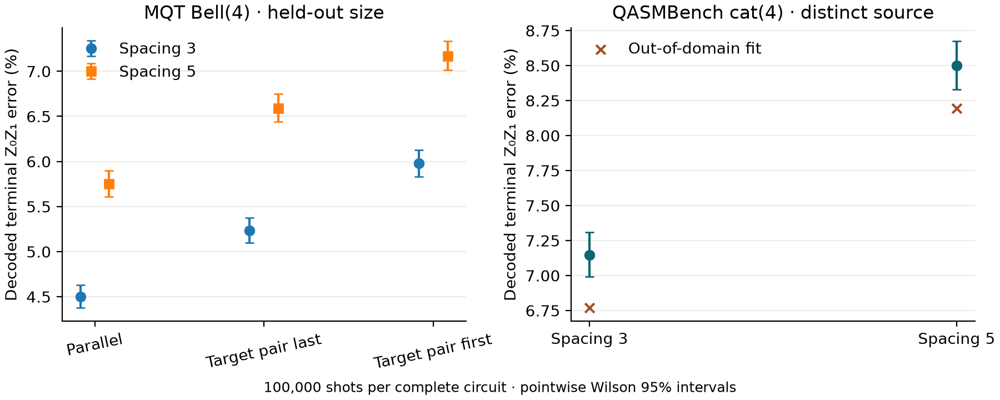

# 2026-11-05｜共同終端 parity、受限 front 決策與正式報告

## 新增了什麼

本輪以完整電路的共同終端讀出 Z₀Z₁ 為目標。開發資料為先前四份 MQT Bell(6) 電路的 12 筆單 parity labels，按四個完整電路分群。測試使用同家族新尺寸 **MQT Bell(4)**，以及相依結構不同的 **QASMBench cat_state_n4**。模型、測試候選與選擇結果於新取樣前凍結。Bell(4) 使用與 Bell(6) 相同的固定上游 generator，完整保留 2 H、2 CX、1 barrier、4 次量測。cat 保留 1 H、3 CX、4 次量測，只有一條合法 CX 順序，故用於跨來源轉移與拒絕判斷。

[來源與 SHA-256](../../benchmarks/public_2026-11-05/manifest.json) · [事前凍結](../../results/transfer_2026-11-05/frozen.json) · [開始取樣](../../results/transfer_2026-11-05/run_start.json)

## 方法

- Bell(6) 開發校準以 physical layers、目標 CX 的 ancilla xy blocks、目標配對前後的 protected idle（以 patch-layer 記）做固定 ridge。四個電路各有三個 marginal labels，同一電路內資料可能相關，故保守門檻由 leave-one-**circuit**-out 殘差計算。門檻是敏感度規則，無統計覆蓋保證。
- Bell(4) 在 **同時最多一個 CX** 的宣告限制下，第一個 ready front 有兩個等進度行動，各有唯一的合法後續。共用兩份候選、兩次 rollout；以固定順序、純深度、去幾何、去等待、完整風險、完整風險加 guard 比較。這是獨立的受限 front 實作，未接入通用 DASCOT 搜尋。
- 無 cap 時保留完整並行選擇。兩個來源各做原政策、one-step、two-step 的相同預算／候選控制，共 60 組設定。Bell(4) 全選並行，cat 全選單一合法順序；精確相同的完整計畫重用 counts，新增 shots=0。作者政策在共同 profile 下是額外參考。
- 每個測試 circuit 都做 signed inputs、原始讀出、已知 final faults、全部八個 X/Z generators 與 graphlike distance 檢查。PyMatching 在原完整 DEM 上解碼，再以 GF(2) 找出原始 Z₀Z₁ 的 observable mask。若 mask 有多位，逐 shot XOR；本輪八個實測電路均為單一 generator。另保留 any-error 批次計數，不混入 parity 比較。

## 實測結果

8 個不同完整電路，**新增 800,000 noisy shots**。每電路 100,000 shots，d=3、p=0.001、TQEC uniform-depolarizing circuit noise、ordinary uncorrelated PyMatching MWPM（decomposed DEM）。單率 CI 為 pointwise Wilson 95%。

| 電路與條件 | CX steps | H layers | Template block-z | QEC rounds | TICKs | Qubits | Z₀Z₁ errors / shots | Wilson 95% |
|---|---:|---:|---:|---|---:|---:|---|---|
| Bell(4), s3, 並行 | 1 | 1 | 6 | 未推算 | 153 | 386 | 4501 / 100000 | [4.374%, 4.631%] |
| Bell(4), s3, 目標配對先做 | 2 | 1 | 9 | 未推算 | 216 | 386 | 5978 / 100000 | [5.833%, 6.127%] |
| Bell(4), s3, 目標配對後做 | 2 | 1 | 9 | 未推算 | 216 | 386 | 5235 / 100000 | [5.099%, 5.375%] |
| Bell(4), s5, 並行 | 1 | 1 | 6 | 未推算 | 153 | 610 | 5750 / 100000 | [5.607%, 5.896%] |
| Bell(4), s5, 目標配對先做 | 2 | 1 | 9 | 未推算 | 216 | 610 | 7171 / 100000 | [7.013%, 7.333%] |
| Bell(4), s5, 目標配對後做 | 2 | 1 | 9 | 未推算 | 216 | 610 | 6592 / 100000 | [6.440%, 6.747%] |
| cat(4), s3, 原始 chain | 3 | 1 | 12 | 未推算 | 279 | 529 | 7148 / 100000 | [6.990%, 7.309%] |
| cat(4), s5, 原始 chain | 3 | 1 | 12 | 未推算 | 279 | 865 | 8499 / 100000 | [8.328%, 8.673%] |

在相同幾何下，單 CX cap 的兩份 Bell(4) 排程有相同 TICK、qubits、總 ancilla 與 data 保留量，差異在目標配對的等待位置。完整風險與去幾何版都選目標配對後做，去等待版回到固定順序。完整風險相對固定順序為 **−0.743 個百分點**（Newcombe95 [−0.945, −0.541]）及 **−0.579 個百分點**（[−0.801, −0.357]）。Guard 所需 logit 差為 0.2964，實際模型差 0.0936，故兩個幾何都保留基準，差值 0。無 cap 的並行排程在兩個幾何均有最低的指定 parity 錯誤率。指定 parity 的收益不代表其他配對或任一 observable error 同時改善。

cat(4) 在兩個幾何均有另一個 CX 接觸目標配對，超出 Bell 校準的結構域。未套 guard 的診斷預測約 6.768%／8.194%，實測 7.148%／8.499%；兩點的幾何方向相同，guard 仍拒絕部署。這驗證跨來源的支援域檢查，跨來源的排程選擇收益仍需有多候選且支援域匹配的新來源。

[逐批原始紀錄](../../results/transfer_2026-11-05/samples) · [差值與 60 組路由控制](../../results/transfer_2026-11-05/evaluation.json) · [獨立 scorer 計時](../../results/transfer_2026-11-05/selector_timing_isolated.json)

時間政策仍是每 H/CX layer 3 block-z，barrier 零時間，TICK 直接由編譯器計數，總 QEC rounds 未推算。現有 routing-only 基準以 11/3、11/4 的 25 次重複為準。此輪另以相同已建候選池做 scorer-only 計時，固定順序約 0.16–0.17 μs，執行全套評分與消融約 63 μs。這個數字排除 route 枚舉、編譯、校準及 Monte Carlo，不等同 routing wall time。

## 驗證、文件與後續

- 8 個 ideal/noisy/DEM hashes、完整 source 與 plan、逐批 counts、Wilson CI、差值、凍結選擇及 60 組無 cap 計畫均可重播。
- 完整公開來源覆蓋為 **4/9 個固定實例**，其中 QASMBench 為 2/7，另有 MQT Bell(4)、Bell(6) 兩個實例。cat 是 chain 對照，未提供競爭排程。原較大型 Phase 1 工作負載尚未轉譯。
- 在 [相關工作差異表](../RELATED_WORK_2026-11-04_ZH.md) 補上 CircLS 橋接的串行條件與時間政策。這次未重跑 CircLS，其作者數字不加入本案控制組。
- 正式報告材料包含 15 頁白底英文簡報／PDF、[中文朗讀稿](../report_2026-11-09/DASCOT_Speaker_Script_ZH.md)、[理解補充](../report_2026-11-09/DASCOT_Study_Guide_ZH.md)、[問答](../report_2026-11-09/DASCOT_QA_ZH.md) 和可重現快照。源碼、原始 circuits、DEM、labels、校準與決策凍結、CI、圖表及驗證紀錄一併保留。
- 通用 scheduler 的 **μ=0**。後續研究需要另一個確有候選競爭且 observable／特徵支援域匹配的來源，再測跨來源排序，並將受限第一-front 規則擴充到多階段選擇。現有結果可完整展示收益、持平及停止外推的案例。

## 重現

先依 README 建立 Python 3.12／requirements lock，並放置固定版 wisq。依序執行 python restore_results.py、python report_transfer_pilot.py、python -m pytest tests -q。重跑抽樣時另選新目錄，先 prepare，再以 Git 固定設計與實作，最後 run。快照另有以完整 hashes 驗證的預先凍結 Git bundle。
